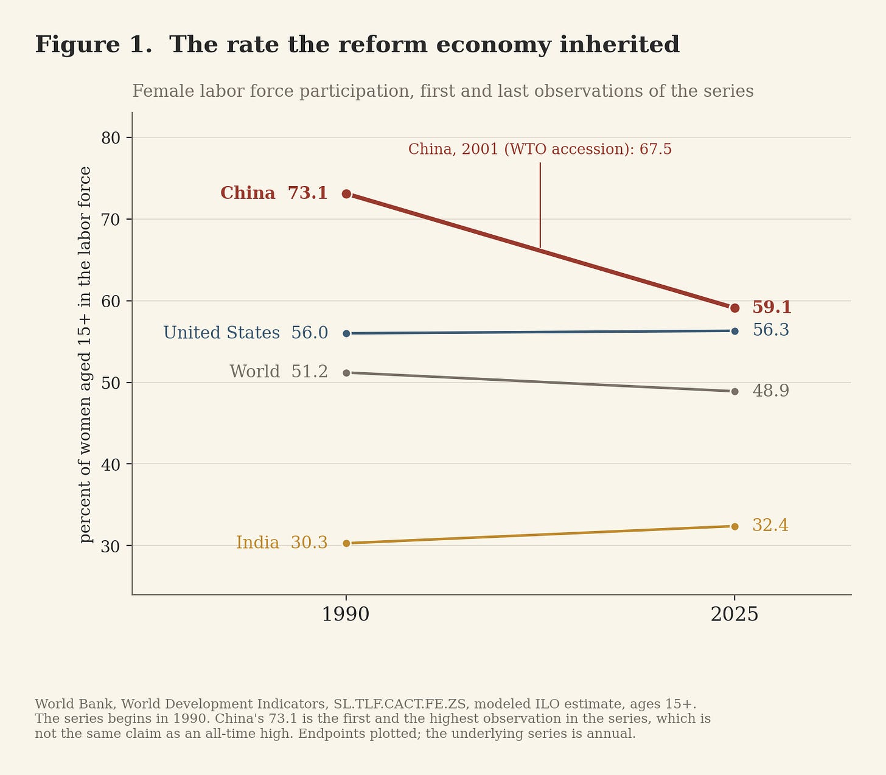
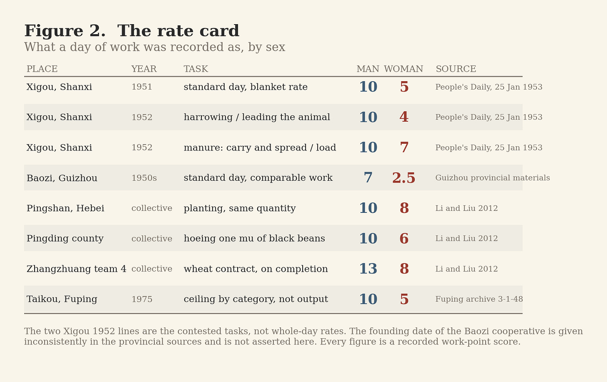
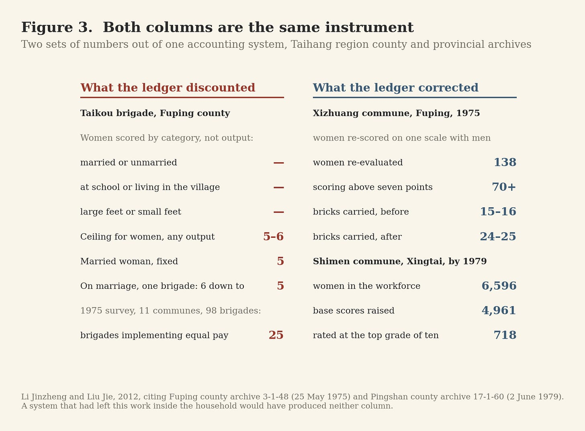
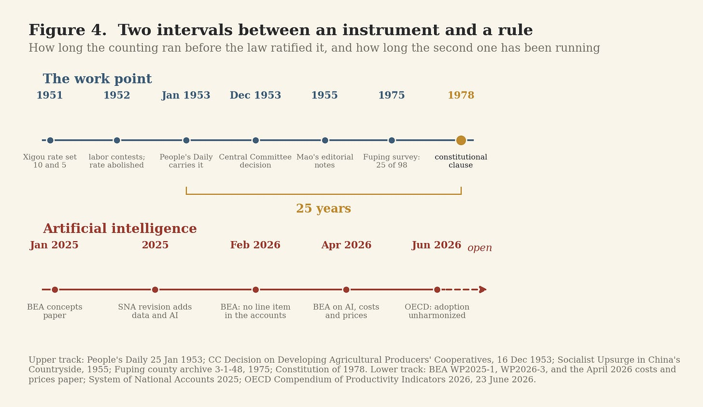

# Seven Points and Two and a Half

>The ledger that counted women into China's economy, and what it is now deciding about AI.

In the middle of the tenth century, before Portugal was a kingdom, Mumadona Dias governed much of the territory around what is now Guimarães. Around 950 she founded a monastery there and ordered a fortress built on the hill above it to protect the monastery and the people gathering around it. The two institutions became the anchors of the city that followed. The castle, rebuilt many times since, is still standing.

She is remembered the way exceptional women are remembered.

She got through.

Economic history has the harder subject. It has to account for the people who left no charter, no castle and no biography. They become visible only when an institution decides to write them down.

That is where this starts.

---

## The number that begins at 73

The World Bank’s modeled ILO series for female labor force participation in China begins in 1990. Its first observation is 73.1 percent of women aged fifteen and over, working or looking for work. It is also the highest observation in the series.

The 2025 figure is 59.1 percent.

The dates require care. China in 1990 was already twelve years into reform. This is not a before-and-after experiment, and women’s participation did not produce China’s subsequent growth by itself.

The sequence still matters.

China entered the 1990s, before WTO accession and before the great expansion of export manufacturing, with nearly three-quarters of adult women in the labor force. On the same series, the world figure that year was 51.2 percent. The United States was 56.0. India was 30.3.

The reform economy therefore did not have to create women’s economic participation from nothing. It arrived to find participation in production already normalized to a degree unusual for China’s income level.

The standard account of China’s rise begins with special economic zones, foreign capital, infrastructure, migration, WTO accession and supply chains.

What that list treats as given is the labor force that turned up to use them.

It was not given.

It had been built.

---

## The house in Tianjin

Part of the building began before the People’s Republic existed.

For me this part is also family history. Yan Xiu was my grandfather’s grandfather, which makes him my great-great-grandfather.

In the autumn of 1902 he traveled to Japan at his own expense to study education. He went to find out why Japan had grown strong, and he spent part of the trip inspecting girls’ schools and kindergartens. That winter, back in Tianjin, he opened a school inside the family compound for the girls of the household and of related families.

The students were roughly ten to twenty years old. They studied Chinese, English, arithmetic, Japanese, music, drawing and practical subjects. Yan taught composition himself. He also wrote an anti-footbinding song, the _Fangzu Ge_, and taught the girls to sing it. _Ta Kung Pao_ later described the school as a starting point for the revival of women’s education. In 1905 the household school became a formal girls’ school with primary and middle sections.

In the winter of 1905 an eleven-year-old from a Tianjin Hui merchant family enrolled there. Her name was Liu Qingyang.

The other educational line running out of the same household became Nankai. Yan Xiu and Zhang Boling founded the school that became Nankai Middle School in October 1904, and Nankai University in 1919.

What follows is documented and it forms a closed circuit.

On 16 September 1919 the Awakening Society was founded in Tianjin by twenty students, deliberately constituted as ten men and ten women. Liu Qingyang was one. Zhou Enlai was another. In the autumn of 1920 Xu Guiying enrolled in the arts faculty of Nankai University, its first woman student. That same autumn Zhou, arrested in January and expelled from the university on his release, had no school and no money; Yan Xiu endowed the Fansun Scholarship with seven thousand silver dollars to send him and one classmate to Europe. Zhou sailed on 7 November 1920. When Yan Xiu was told that his beneficiary had turned revolutionary and that the money should stop, he answered that every man holds his own aspiration and cannot be compelled, and kept paying.

In Paris in the spring of 1921, Liu Qingyang and Zhang Shenfu brought Zhou Enlai into the early communist organization there.

None of this should be turned into a story of intended causation. Yan Xiu did not educate girls in 1902 in order to produce a communist organizer twenty years later, and he did not fund Zhou in order to produce a premier.

The point is narrower and it is structural. An institution that widens the field of people able to participate produces consequences its founders cannot specify in advance. A room in a Tianjin house taught girls who would otherwise have stayed outside the system entirely. Capability came first. What it produced came later, and came through people rather than through plans.

Half a century after my great-great-grandfather opened that classroom, another institution met the same population from a different direction.

---

This one carried a number.**Ten points and five**

Under agricultural collectivization, production teams recorded labor in work points.

The system was an accounting device. A member accumulated points through the year, and what those points were worth stayed unknown until production and procurement had been settled. The unit remained abstract for most of the year, which is precisely what made it arguable.

For women the consequential change was that agricultural labor previously absorbed into household production became individually countable. Once a contribution entered an account it carried a name and a figure.

A figure invites comparison.

Comparison is what made the discount visible.

At Xigou village in Pingshun County, Shanxi, the cooperative formed in December 1951 under Li Shunda recorded ten points for a man’s day and five for a woman’s. Two women’s labor counted as one man’s. The women had a name for the rate. They called it _lao wu fen_, the old five points.

Shen Jilan, twenty-one years old and the cooperative’s deputy head, was asked to bring the women into the fields because the men alone could not complete the plan. She found that mobilization was not the binding problem. The women came and the rate stayed.

So the women tested the number against the work.

Harrowing took two people. Leading the draft animal scored four points. Standing on the harrow scored ten. The woman leading the animal asked why she was not the one on the harrow. They swapped, and she harrowed for the rest of the afternoon.

In the spring of 1952 the manure had to be spread before sowing. Men carried and spread at ten points; women loaded at seven. The men said spreading took skill. The women proposed a contest over equal ground, equal numbers, both sides starting together. They finished first. Further contests followed in plowing, thinning and hoeing, and the men conceded.

The cooperative abolished the blanket women’s rate and re-scored on the task. Three women were rated at ten points. At the summer review, nine of the cooperative’s twenty-one model workers were women.

On 25 January 1953 _People’s Daily_ carried the account across a full page, under a phrase Shen Jilan had used at a prefectural meeting the previous December: labor is liberation, and standing comes from struggle. Provincial party papers reprinted it. On 16 December 1953 the Central Committee wrote the principle into its decision on developing agricultural producers’ cooperatives in operational language: equal work, equal pay; more work, more pay.

Guizhou produced a harder version of the same problem. At Baozi village in Xifeng County the cooperative recorded seven points for a man’s day and two and a half for a woman’s, including for comparable work. The women contested it and won. After the rate changed, twenty-two of the cooperative’s twenty-three women joined collective production, and work that had taken ten days was finishing in seven or eight.

That ratio gives this essay its title, because it reduces the institutional problem to four words.

Seven points. Two and a half.

The labor was visible. So was the discount.

In September and December 1955 Chairman Mao edited _Socialist Upsurge in China’s Countryside_, writing two prefaces and one hundred and four editorial notes. Three of the notes concern equal pay. The note attached to the Guizhou report runs to a single line: the piece is short, easy to read, and every township and cooperative should do the same.

An instruction from the center did not settle it.

---

## The correction is in the same ledger

Li Jinzheng and Liu Jie worked through county and provincial archives across the Taihang range, where the policy began, and found unequal scoring running through the thirty collective years.

At a brigade in Pingshan County a man and a woman planted the same crop in the same quantity; he was recorded at ten points and she at eight. At a team in Pingding County, hoeing one _mu_ of black beans scored ten for a man and six for a woman. At another team, twenty members contracted nine _mu_ of wheat for one hundred and sixty points, eight apiece; on completion the men were written up at thirteen and the women stayed at eight.

At Taikou brigade in Fuping County the rule for women had nothing to do with output at all. Women were classified by whether they were married, whether they were at school or living in the village, and whether their feet were large or small. The ceiling was five or six points however capable the woman. Married women were fixed at five. At a neighboring brigade a woman’s score fell from six to five on marriage, and in some cases to three and a half, while young men who could not do ten-point work were written up to ten.

Seventy-three years after Yan Xiu wrote a song against footbinding and taught it to the girls in his house, foot size was still an input to a wage formula.

A survey in May 1975 covering eleven communes and ninety-eight brigades in Fuping found the equal-pay policy implemented in twenty-five of them.

The authors are careful about what follows, and their caution sharpens the argument rather than blunting it. Where a task was measured and contracted, a gap in the score is unequal pay for equal work and nothing else. Where scoring was fixed by grade rather than by task, part of the gap tracked a real difference in the work and part of it did not, and the two are hard to separate at this distance. Women also carried the domestic load, which the ledger never recorded at all.

Now read the other column in the same archives.

At Xizhuang commune in Fuping in 1975, women were re-evaluated on one scale with men. Of 138 women, more than seventy scored above seven points. Attendance rose and measured output rose with it. At the brick kiln, loading and unloading that had taken three or four days took two, and women who had carried fifteen or sixteen bricks carried twenty-four or twenty-five. At Shimen commune in Xingtai County, women were 6,596 of 12,800 workers; by 1979, 4,961 of them had had their base scores raised and 718 were rated at the top grade of ten.

Hold the two sets of numbers together, because they came out of one instrument.

The ledger made the discount legible. The ledger made the correction legible. A system that had left this work inside the household would have produced neither record. There would have been nothing to contest and nothing to show afterward.

That is the whole case for measurement, and also the whole case against trusting a measurement system merely because it produces numbers

---

## What I saw of it

I have one small piece of direct evidence, and I want it on the record rather than in a footnote.

In the early 1970s my uncle was sent to the countryside for re-education. My cousin Ci Bao was working there in the production team. I stayed with them.

What I remember about the work points is not a grievance. It is how ordinary the arithmetic was. Ci Bao explained the scoring to me the way a person explains the weather: this is what a day is worth, this is what a woman’s day is worth, this is who writes it down at night. Nobody called it policy. It was simply the number.

That is the condition the archives describe from the inside. A rate that is written every evening in a book stops being an argument and becomes a fact about the world. It also stays in the book, which is the reason a researcher can read it fifty years later and the reason the women at Xigou had something to point at.

---

## The clause arrives in 1978

The 1954 Constitution guaranteed women equal rights with men in political, economic, cultural, social and family life. That provision is Article 96, and it says nothing about pay. The 1975 Constitution reduced the wording further.

Equal pay for equal work entered the constitutional text in 1978. The 1982 Constitution carries it in Article 48: the state protects the rights and interests of women, applies equal pay for equal work, and trains and selects women cadres. The National People’s Congress commentary on Article 48 identifies 1978 as the point at which the equal-pay provision was added.

This correction matters, because a good deal of Chinese public writing, and at least one scholarly article on the Taihang cases, places the clause in September 1954 and cites the 1982 article number to support it.

Now look at the sequence.

The women at Xigou argued the rate in 1952. _People’s Daily_ put the case into the national record in January 1953. The Central Committee adopted the principle in December 1953. Chairman Mao endorsed three cooperative reports on it in 1955. The constitutional clause arrived in 1978.

Twenty-five years separate the accounting practice from the constitutional ratification — and the order of arrival is the point, because the instrument that made the claim provable came first, and the law came afterward to formalize what people had already been arguing over, testing and enforcing inside the productive system.

---

## What reform inherited, and what it did not keep

The inheritance was not permanent.

As collective agriculture, planned employment and work-unit welfare receded, women’s participation fell. The literature offers several explanations rather than one: wage structure, childcare and household responsibility, longer schooling, life-cycle effects, employment restructuring, and the interaction between liberalization and prevailing gender norms. Denise Hare’s study of urban married women from 1991 to 2011 sits there, and a 2026 paper in _Labour Economics_ finds that liberalization pressed hardest on women’s participation in the regions where traditional norms ran strongest.

So the tempting sentence, that the market inherited the rate, goes one causal step too far.

What disappeared was the explicit village rate card. Gendered valuation did not disappear with it. It moved into wages, occupations, hiring, promotion, household constraints and social expectation, where it is harder to hold up and point at.

The fall from 73.1 to 59.1 is not evidence that one accounting system caused another. It is evidence of something narrower and more useful. Productive capacity built by institutions can be lost, redirected or made harder to use when those institutions change.

---

## Where the parallel stops

Four limits, stated so the argument can break on them.

Female labor force participation is not a development score. Claudia Goldin’s work shows participation following a U-shaped path: falling as production leaves farms and households, rising again as schooling spreads and white-collar employment opens. A falling rate is not by itself evidence of institutional regression, and this essay does not treat it as one.

Participation is not freedom. The socialist mobilization of Chinese women into production was in large part a state project. Domestic labor stayed disproportionately female, which left many women with the field shift and the household shift. A ledger can establish that somebody worked. It cannot establish that she chose to.

Measurement is not sufficient. Stephan Klasen and Francesca Lamanna find substantial associations between gender gaps in education and employment and slower growth, and they state the reverse-causality problem themselves rather than leaving it to a critic. Esther Duflo’s survey warns against assuming that development delivers empowerment or that empowerment delivers development. Institutions mediate the result in both directions.

And national accounts do not set the price of AI the way a production team assigned a work point. A statistical category is not a wage rate. That is where the analogy stops.

The connection sits one level below the analogy. Both problems begin with legibility.

What survives all of this is modest and it holds. A society that prevents people from developing or deploying capabilities makes itself poorer than it needs to be. Removing the constraint guarantees nothing. Leaving it in place costs something.

---

## The ancestor

Statistical agencies are now deciding how artificial intelligence becomes visible in the economy, and they are saying so in public.

In February 2026 the U.S. Bureau of Economic Analysis opened a working paper by stating that there is “not a line item in the U.S. national accounts” by which the economic impact of AI can be identified and measured, and that the impact therefore has to be estimated indirectly through the industry accounts. That paper is the second of three in fifteen months: a concepts paper in January 2025 setting out a thematic satellite account for AI production across manufacturing, software publishing, computer and data services and research and development, and a further paper in April 2026 on AI, costs and prices.

The 2025 revision of the System of National Accounts brings data and AI into the assets a country records, and BEA has begun publishing experimental estimates for capitalizing own-account data.

The OECD reported in June 2026 that measures of AI adoption are not harmonized across countries, and that surveys inside a single country return different answers because they define AI differently.

Something is being produced at very large scale and the accounting system has no settled name for it.

The unresolved questions are the old ones. What counts as investment and what counts as expense. Where the gain lands when a person and a model produce something together. How much belongs to the model, how much to the data, how much to the reorganization around it, and how much to the human judgment applied. What happens to output that becomes better rather than faster. How a statistical system treats value delivered free, bundled, or inside a firm.

These sound technical because accounting questions sound technical right up to the moment institutions begin attaching consequences to the answers.

Before AI is governed, taxed, priced or compared, somebody decides what the unit is.

Then somebody decides what it is worth.

That is the sense in which the work point is an ancestor of AI. The ancestry does not sit at the level of the subject: AI is not analogous to women, and the collective farm is not a model for the digital economy. It sits at the level of the institution. A new source of productive capacity appears, and the accounting system in place has to decide how to represent it.

The work point shows both halves of that decision inside one generation. Capacity that goes uncounted drops out of every choice that allocates anything else. Capacity that is counted badly becomes highly visible and systematically mispriced. Both happened to the same women, in the same decade, in the same book.

A country’s productive capacity is therefore not its people, its capital, its machines or its models. It is the portion of all of that which its institutions know how to recognize, organize and put a figure against.

Mumadona’s castle is easy to see, because stone survives.

Yan Xiu’s classroom is easy to miss. So are the millions of days of work entered into county ledgers under names no history will carry.

The books survive. That is why the discount and the correction are both still readable.

AI has ancestors.

One of them is a ledger.

---

## Notes and sources

**Primary documents, in order of event**

Yan Xiu (严修, 1860–1929). Autumn 1902 study visit to Japan including girls’ schools and kindergartens; the Yan family girls’ school (严氏女塾) opened in the winter of 1902 for daughters, daughters-in-law and nieces of the household and of related families; curriculum in Chinese, English, arithmetic, Japanese, music, drawing, handwork and weaving; the _Fangzu Ge_ (《放足歌》) anti-footbinding song taught to the students; _Ta Kung Pao_ description of the school as a starting point for the revival of women’s education; conversion to a formal girls’ school (严氏女学) in 1905. Nankai University historical materials and Tianjin local-history sources.

Liu Qingyang (刘清扬, 1894–1977). Enrolled at the Yan family girls’ school in the winter of 1905; entered the Zhili First Women’s Normal School in 1909; co-founder of the Awakening Society (觉悟社), Tianjin, 16 September 1919, constituted as ten men and ten women; traveled to France in November 1920; joined the Party in Paris in February 1921 and, with Zhang Shenfu, brought Zhou Enlai in.

Nankai. 敬业中学堂 founded October 1904 by Yan Xiu and Zhang Boling, later Nankai Middle School; Nankai University opened 25 September 1919 with 96 students, Zhou Enlai student number 62 in the first arts cohort; Xu Guiying (许桂英) enrolled in the arts faculty in the autumn of 1920 as the university’s first woman student.

Fansun Scholarship (范孙奖学金). Endowed by Yan Xiu with 7,000 silver dollars after Zhou Enlai’s expulsion, funding Zhou and Li Fujing to study in Europe; Zhou sailed for France on 7 November 1920 with the fifteenth work-study cohort. Edgar Snow records in _Red Star Over China_ that Zhou’s supporter in Europe was a founder of Nankai.

蓝邨, 《”劳动就是解放，斗争才有地位”——李顺达农林畜牧生产合作社妇女争取同工同酬的经过》, _人民日报_, 25 January 1953. The Xigou account, approximately 5,000 characters, reprinted by provincial party papers.

Central Committee of the Chinese Communist Party, 《关于发展农业生产合作社的决议》, 16 December 1953, equal-pay provision.

中共中央办公厅 (ed.), 《中国农村的社会主义高潮》, 1955, three volumes. Two prefaces and 104 editorial notes by Mao, September and December 1955; three notes concern equal pay, each attached to a named report, including 《在合作社内实行男女同工同酬》.

Archival records cited by Li and Liu (2012): 中共西庄公社委员会, 《关于落实男女同工同酬政策试点工作的情况报告》, 25 May 1975, 阜平县档案馆 3-1-48 (the eleven-commune, ninety-eight-brigade survey and the Taikou classification); 河北省妇女联合会, 《南石门公社党委是怎样巩固男女同工同酬成果的》, 2 June 1979, 平山县档案馆 17-1-60 (the Xingtai figures).

Constitution of the People’s Republic of China, 20 September 1954, Article 96; Constitution of 1975; Constitution of 1978, first constitutional statement of equal pay for equal work; Constitution of 1982, Article 48. National People’s Congress constitutional commentary on Article 48.

**Data series**

World Bank, World Development Indicators, SL.TLF.CACT.FE.ZS, labor force participation rate, female, ages 15+, modeled ILO estimate, sourced from ILOSTAT. China 1990 = 73.09; 2001 = 67.50; 2025 = 59.15. World 1990 = 51.2, 2025 = 48.9. United States 1990 = 56.0, 2025 = 56.3. India 1990 = 30.3, 2025 = 32.4. The series begins in 1990. China’s 73.1 is the first and the highest observation in the series, which is not the same claim as an all-time high.

**Scholarly literature**

Arunabh Ghosh, “Work Points in the People’s Republic of China, 1950s to the 1980s,” _Isis_ 116, no. 1 (March 2025): 146–157. DOI 10.1086/734001.

Nicola Spakowski, “Women Labour Models and Socialist Transformation in early 1950s China,” _International Review of Social History_ 67, S30 (2022): 131–154. DOI 10.1017/S0020859021000705.

李金铮、刘洁, 《劳力·平等·性别：集体化时期太行山区的男女”同工同酬”》, 《中共党史研究》 2012年第7期, 53–61.

宋少鹏, 《价值、制度、事件：”男女同工同酬”与劳动妇女主体的生成》.

Denise Hare, “What Accounts for the Decline in Labor Force Participation among Married Women in Urban China, 1991–2011?” _China Economic Review_ 38 (2016): 251–266. DOI 10.1016/j.chieco.2016.01.004.

Qi Zhang and Bin Zhao, “China’s labour market liberalization harmed women, but more so in regions with traditional gender norms,” _Labour Economics_ 99 (April 2026): 102862. DOI 10.1016/j.labeco.2026.102862.

Claudia Goldin, “The U-Shaped Female Labor Force Function in Economic Development and Economic History,” NBER Working Paper 4707 (1994). DOI 10.3386/w4707.

Stephan Klasen and Francesca Lamanna, “The Impact of Gender Inequality in Education and Employment on Economic Growth: New Evidence for a Panel of Countries,” _Feminist Economics_ 15, no. 3 (2009): 91–132. DOI 10.1080/13545700902893106.

Esther Duflo, “Women Empowerment and Economic Development,” _Journal of Economic Literature_ 50, no. 4 (2012): 1051–1079. DOI 10.1257/jel.50.4.1051.

**Measurement of AI**

Tina Highfill and Jon D. Samuels, “Early Estimates of the Impact of AI Within BEA’s Industry Economic Accounts,” BEA Working Paper WP2026-3, February 2026.

Tina Highfill and Jon D. Samuels, “Early Evidence on the Relationship Between AI, Costs, and Prices Within BEA’s Industry Economic Accounts,” BEA working paper, April 2026.

Tina Highfill, David B. Wasshausen and Gregory Prunchak, “Concepts and Challenges of Measuring Production of Artificial Intelligence in the U.S. Economy,” BEA Working Paper WP2025-1, January 2025.

J Bayoán Santiago Calderón, “Toward Economic Statistics on Own-Account Data and Databases Assets for 1997–2024,” BEA Working Paper WP2026-4; and Jon D. Samuels, J Bayoán Santiago Calderón and Corby Garner, “The Impact of Capitalizing Data on Productivity Growth in the U.S.,” BEA Working Paper WP2026-7, on the SNA 2025 recommendation to treat own-account data as an intangible capital asset.

OECD, _OECD Compendium of Productivity Indicators 2026_, OECD Publishing, Paris, 23 June 2026, 101 pp. DOI 10.1787/734a5e68-en.

System of National Accounts 2025, treatment of data, cloud services, artificial intelligence and digital platforms within intellectual property products.

**Uruk**

Christopher Woods, “The Earliest Mesopotamian Writing,” in Woods, Emberling and Teeter (eds), _Visible Language: Inventions of Writing in the Ancient Middle East and Beyond_, Oriental Institute Museum Publications 32. Approximately 5,000 proto-cuneiform tablets and fragments, Uruk IV–III, c. 3350–3000 BC, almost entirely administrative; no literary texts among the earliest.

**Guimarães**

Paço dos Duques de Bragança, institutional materials on Mumadona Dias and the Castelo de Guimarães. The tenth-century foundation dates are given in a range across sources; no single year is asserted here because nothing in the argument depends on one.

**Author testimony**

The author is the primary source for his own family history. Yan Xiu is the author’s grandfather’s grandfather, which is to say his great-great-grandfather. The account of the production team in the early 1970s, and of what the author was told there about the men’s and women’s rates, is author testimony and is presented as such.

Two further items are recorded here as family testimony rather than as history, because no public source carries them, and because a family record should hold what it knows about itself.

First: the author’s grandfather, Louis Yan, said that he had acted opposite Zhou Enlai in the Nankai drama society, in the years when the school would not put boys and girls on one stage and Zhou therefore played the women’s parts. He said that decades later, when Zhou as premier assisted him, Zhou joked that the two of them had once been married.

Second: the documented facts around that story stand on their own. Zhou Enlai entered Nankai Middle School in August 1913 on the school’s single free place. He played the female lead Sun Huijuan in 《一元钱》 at the school’s eleventh-anniversary performance on 17 October 1915, and Nora in _A Doll’s House_. Mei Lanfang saw the Beijing run and discussed cross-gender technique with him afterward.