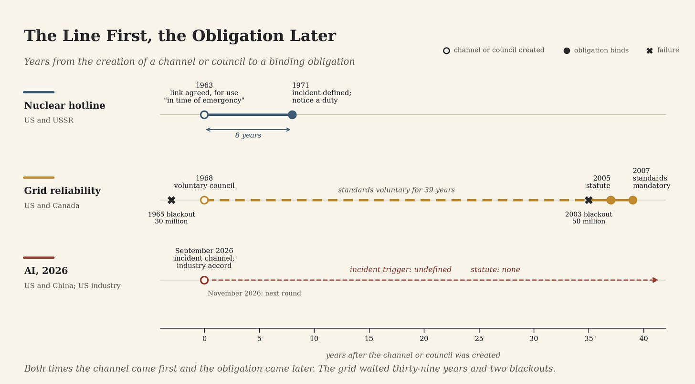
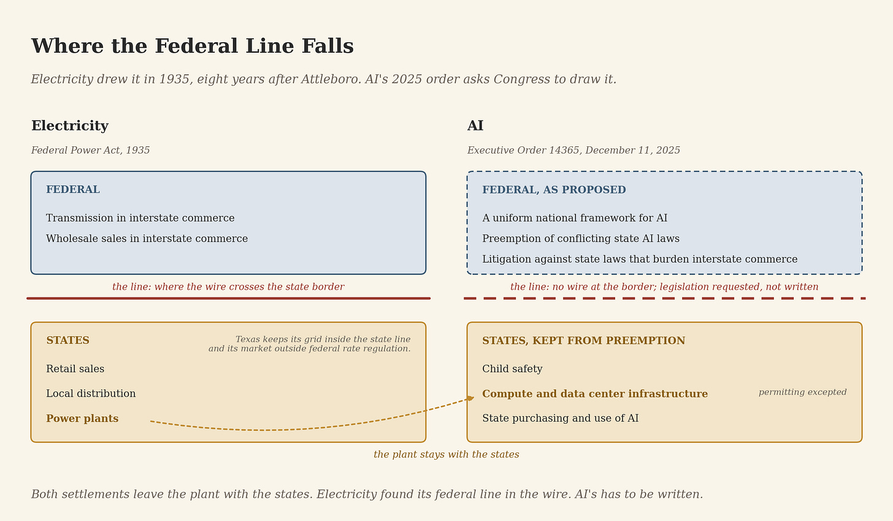
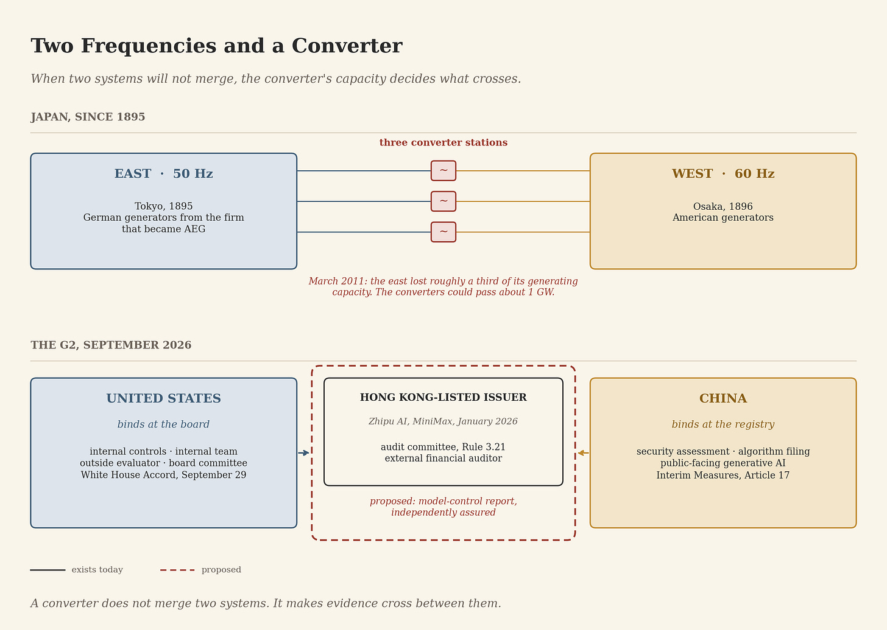

# Where the Rule Binds

>Part III: The Converter
>
> _Part II closed on seven asks for the September talks. The last week of the month delivered a table, a board and a toolchain. This part grades them against the ancestor this project has already chosen for AI, which is electricity, and asks where two systems that will not merge are going to meet._
> 
> Part II ended with a set of asks for the September talks between Washington and Beijing. Agree what a frontier training facility is. Agree what a compute declaration contains. Test whether declared workloads can be told apart from prohibited ones. Establish what energy data can and cannot establish. Protect commercial and security-sensitive information. Decide what happens when two measurements disagree. Name counterparts who will still be there in a year.
> 
> The last week of September answered in three installments. On September 24, the two presidents set up a dialogue and a channel for incidents. On September 29, six technology leaders signed a governance accord at the White House. On September 30, DeepSeek released an open-source toolkit for programming Huawei’s AI chips without Nvidia’s software.
> 
> Part II also ended on a meter. This part follows the wire.
> 
> In July, _The Wrong Ancestor_ argued that AI’s productive ancestor is electrification rather than the internet. The ancestor governs as well as produces. Electricity took more than a century to build the institutions that make a grid governable: state commissions, a federal line, securities law, a reliability organization with the power to fine, and converters between systems that never merged. Read against that history, the month says three things. The United States and China are separating at the governance layer as well as in silicon. Washington is running its domestic argument on the electrical timetable. And the world between the two needs the piece of equipment electricity learned to size only after a disaster.
> 

## The table

The White House fact sheet on President Xi’s state visit sets out a US-China Super Intelligence Dialogue on risks and benefits, a next exchange by November, and a bilateral channel for incidents. China’s eight-point readout records the same dialogue, the same November round and the same channel, under the name China-US AI dialogue. In New York in the days before the visit, Treasury Secretary Scott Bessent had proposed to Vice Premier He Lifeng that the two sides notify each other of AI safety incidents.

Graded against Part II’s list, the result earns one partial mark out of seven, on the last ask: a standing channel with a date on it, though the published documents name no leads for the new dialogue. Nothing was agreed on definitions, declarations, tests or disputed measurements. The fact sheet does not say what an incident is. Washington proposed notifications and settled for a line.

The same week, the definition problem moved inside Washington. An executive order directed federal agencies to use “Super Intelligence” and to stop using “Artificial Intelligence” and “AI.” It gives the President’s science adviser sixty days to determine how far the new term should supersede the statutory definition of artificial intelligence, which Congress enacted in the National Artificial Intelligence Initiative Act of 2020 and which remains the law. The executive branch now has one noun and the statute book another, and Beijing’s readout agrees with the statute book. The sixty days run out in late November, beside the next round.

The last great rivalry shows how long the next step took. The United States and the Soviet Union signed the memorandum establishing the Direct Communications Link in Geneva on June 20, 1963, eight months after the Cuban missile crisis. The link ran on teletype, and the memorandum reserved it for use in time of emergency. It did not say what an emergency was. That came in Washington on September 30, 1971, with the Agreement on Measures to Reduce the Risk of Outbreak of Nuclear War. Article 2 obliged each side to notify the other immediately of any accidental, unauthorized or unexplained incident involving a possible nuclear detonation. Article 6 made the link the primary channel for doing it.

The line came first. The trigger took eight years.

Models are not warheads, and Part II said so. The sequence is what carries over: first the means to talk, then the event that obliges talking. The AI channel sits at the 1963 stage. November shows whether the second stage arrives in weeks or in years. One difference favors speed. The 1963 link followed a near miss. This one precedes any comparable crisis.

President Trump marked the edge of the arrangement on September 29. At an event in Washington he ruled out a joint US-China venture on the technology, on the ground that it would mean giving away secrets. “Frankly, there is nobody in third place,” he said, and “it’s all between us and China.” The channel stands beside that statement without contradicting it. Competition without integration, with a line kept open against accident, is the posture the two nuclear powers held for decades.

Stanford’s 2026 AI Index supports his ranking. It put the gap between the top American and Chinese models on the Arena leaderboard at 2.7 percent in March. Private AI investment in 2025 ran at $285.9 billion in the United States against $12.4 billion in China, and the report notes that the private figure understates Chinese spending, because state guidance funds sit outside it. Two stacks reach the same frontier by different routes.

## The board

The document signed on September 29 is titled the White House Accord on Super Intelligence: Joint Commitment on Frontier Responsibilities. Its signatories are Sundar Pichai, Dario Amodei, Mark Zuckerberg, Greg Brockman, Elon Musk and Jensen Huang. It asks each frontier developer for four things: robust internal controls to monitor the capabilities and alignment of its models across cyber, biological and chemical threats; an empowered internal team to make sure the controls operate as intended; an independent external auditor or evaluator; and an independent committee of the board of directors that oversees the reports and ensures remediation. The companies also commit to meet regularly to establish standards and best practices.

Anyone who has sat through a listed company’s year-end will recognize the shape. Internal controls, an internal audit function, an external auditor and an audit committee of independent directors are the four layers that federal securities law and the New York Stock Exchange require of the American companies it lists. The accord moves that architecture from the ledger to the model.

In finance the architecture holds because of what stands under it. An auditing standard says what the auditor tests. The Public Company Accounting Oversight Board registers and inspects the auditors. Chief executives and chief financial officers certify the accounts personally, and a willful false certification carries up to twenty years in prison. The accord carries none of that. President Trump called it “morally binding.” The text says that over time “it may make sense to codify these steps into laws or regulations.” It does not say what the auditor tests, who qualifies as one, who inspects the auditor, or what an adverse finding triggers.

Part I named this absence the missing profession: no licensure, no duty to those who rely on the finding, no liability for a negligent evaluation, no adversarial access as of right, no venue to try a contested finding. The accord has now written the auditor’s chair into the governance of six companies. Nobody licenses the person who sits in it.

On Part I’s ladder, the accord prescribes a process and binds at the norm rung. Its terminal enforcement object is a signature, where the characteristic failure is irrelevance. Its auditors will produce representations, where the characteristic failure is drift. The six signatories copied the form of the audited firm, not the law that makes the audit hold.

That law has an electrical pedigree. Samuel Insull built a utility empire worth more than four billion dollars as a pyramid of holding companies, and it failed in 1932. Judge Richard Cudahy and William Henderson later counted what it cost: the holdings of 600,000 shareholders and 500,000 bondholders, most of whom believed they had put their savings into a safe electric utility. The Securities Act of 1933, the Securities Exchange Act of 1934 and the utility statutes of 1935 followed, and Cudahy and Henderson called them “a phoenix arising from the ashes of the Insull empire.” Seventy years later the architecture was hardened after another energy company failed. Enron filed for bankruptcy on December 2, 2001. WorldCom’s accounts came apart the following June. President George W. Bush signed Sarbanes-Oxley on July 30, 2002, 240 days after Enron’s filing. The audit machinery the accord borrows was built twice, both times from the wreck of an energy company.

Electricity also ran the accord’s experiment on itself. On November 9, 1965, a blackout left thirty million people in the northeastern United States and Ontario without power, some of them for thirteen hours. The industry answered in 1968 with the National Electric Reliability Council: the utilities, meeting as a body, setting reliability standards for themselves. The standards stayed voluntary for thirty-nine years. On August 14, 2003, fifty million people lost power across the Northeast, the Midwest and Ontario. The joint US-Canadian task force found seven violations of the voluntary standards, and its primary recommendation was that they become mandatory and enforceable, with penalties. The Energy Policy Act of 2005 did it. The industry body, now the North American Electric Reliability Corporation, still writes the standards. The Federal Energy Regulatory Commission approves them, and a violation can cost more than a million dollars a day.

The accord is the 1968 council. The logic for a mandatory regime was available after the first blackout, and what turned the council into law was the second. Codification arrives on the calendar of failure. In finance it took 240 days. On the grid it took two blackouts and thirty-nine years.

The industry has not settled on the 1968 answer. On September 9, OpenAI called for “mandatory, capability-based national AI safety regulation,” with common testing and independent-assessment requirements, and said industry standards should complement mandatory federal safeguards. The accord and that call agree on the auditor. They disagree on whether a statute stands behind it. Electricity settled the same argument in 2005 by declining the choice. The industry body writes the standard, a federal commission approves it, and the penalty is federal. The accord’s own text points that way when it contemplates codification over time.

## The federal line

The accord also fits the direction Washington set before the signing. Executive Order 14365, signed December 11, 2025, makes it the policy of the United States to sustain its AI dominance “through a minimally burdensome national policy framework for AI.” It directs the Attorney General to form a litigation task force against state AI laws that conflict with that policy, including on the ground that they unconstitutionally regulate interstate commerce. It orders the President’s advisers to prepare legislation for a uniform federal framework that preempts conflicting state laws. That legislation must leave alone state rules on child safety, on AI compute and data center infrastructure other than permitting, and on a state’s own purchasing and use of AI.

Electricity fought this fight first, and the task force’s argument is the one that opened it. State commissions led: Wisconsin gave its commission authority over public utilities in 1907, and other states followed. In 1927, in _Public Utilities Commission of Rhode Island v. Attleboro Steam & Electric Co._, the Supreme Court held that Rhode Island could not set the rate a Rhode Island company charged a Massachusetts buyer. The sale crossed a state line, the order placed a direct burden on interstate commerce, and the interest at stake was, in the Court’s words, “essentially national in character.” Only Congress could reach it, and for eight years Congress did not. Interstate wholesale power sat in a gap no state could regulate. The Federal Power Act of 1935 closed it.

The line Congress drew is still the line. Federal authority took transmission and wholesale sales in interstate commerce. The states kept retail sales, local distribution and the power plants. The rule binds where the wire crosses the state line, and Texas shows how literally. Its utilities have kept their grid inside the state for decades, and with it their wholesale market outside federal rate regulation. When Winter Storm Uri arrived in February 2021, the grid could not import the power it needed.

Read the 2025 order against the 1935 statute and the settlement matches in one place. The order proposes to make the rules for AI national and leaves the compute and the data centers with the states. That is the Federal Power Act’s bargain: the plant stays local, and what crosses the line goes national.

The difference is the wire. Electricity gave Congress a physical boundary: an electron crosses the state line or it does not, and a meter can tell. A model served from Virginia answers in Sacramento, Austin and Albany in the same second. No state can keep its AI inside its borders the way Texas kept its grid, so the federal line for AI cannot be read off the physics. It has to be written. An order can direct lawsuits. Drawing the line takes a statute, which is why the order asks for one.

Congress has not written it. OpenAI’s September post proposes that the states set a de facto national baseline first and that Congress codify it afterward, a sequence it calls reverse federalism. That is the electrical sequence exactly: state commissions from 1907, a gap exposed in 1927, a federal statute in 1935. It took twenty-eight years.

## The registry

China placed its binding point elsewhere three years ago. The Interim Measures for the Management of Generative Artificial Intelligence Services took effect on August 15, 2023, issued by the Cyberspace Administration of China with six other national regulators. They cover generative AI services offered to the public in China and exclude research and development that serves no public. Article 17 requires providers of services with public opinion attributes or the capacity for social mobilization to carry out a security assessment and complete algorithm filing.

The American rule, as of this month, binds inside the firm, at a board committee with an outside evaluator reporting to it. The Chinese rule, for public-facing generative AI, binds at a state registry where the provider files. On Part I’s ladder the filing is a process rule with a regulator behind it, one rung below the accord’s norm. Each system has built the governance layer its own institutions know how to run, and nothing announced in September moves either toward the other.

The silicon is moving the same way. DeepSeek’s September 30 release is a free, open-source toolkit for Huawei’s Ascend chips, built around a programming language called TileLang and a set of kernel libraries, and developed, Bloomberg reports, with extensive support from Huawei. Its purpose is to let developers trained on Nvidia’s CUDA move their work to Huawei hardware without learning an unfamiliar system. The programming layer is where developer habits live, and a stack that owns those habits no longer borrows them.

So the update to the G2 picture is this. The divergence this series described as running through chips, clouds and models now runs through the governance layer as well. Two stacks, two binding points, one table between them with no agreed trigger. In electrical terms, two frequencies.

## The converter

Japan has run two frequencies for more than 130 years. Tokyo bought 50-hertz generators from the German firm that became AEG in 1895. Osaka bought 60-hertz generators from the United States in 1896. The east and west of the country grew up on different frequencies and have stayed on them.

What joins them is a small set of frequency converter stations. In March 2011 the earthquake and tsunami knocked out roughly a third of eastern Japan’s generating capacity. Western utilities could send only what the converters could pass: about one million kilowatts across three stations, a fraction of the shortfall. Japan has spent the years since raising that capacity toward three gigawatts.

The United States runs the same arrangement at home, which is how Texas stays apart. Its three grids are not synchronized with one another, and direct-current ties carry power across the seams.

Two lessons carry over. When two systems will not merge, the converter becomes critical infrastructure. And its capacity is set before the crisis that tests it.

The G2 now needs converters at the governance layer: places where an American board attestation and a Chinese state filing can be read against each other on the same company. Hong Kong holds the parts of one.

Zhipu AI listed on the Hong Kong Stock Exchange on January 8, 2026, and MiniMax the next day. Both are mainland developers of large models, and both serve a home market where public-facing generative AI services fall under the filing regime described above. As Hong Kong issuers, both are also bound by Main Board Rule 3.21: an audit committee of at least three non-executive directors, with an independent majority, an independent chair and a member with accounting or financial management expertise. Their annual accounts pass through an external auditor.

The accord’s two independent layers, the board committee and the outside auditor, already exist as listing rules for Chinese labs that raise capital in Hong Kong. Today they cover financial reporting. Extending them to model controls would be a decision for Hong Kong’s listing framework and the issuers inside it, taken under rules that already exist and outside any bilateral negotiation. That is a proposal, and a small one. The same issuer would then carry a mainland filing and an independently assured model-control report, each legible to readers of the other.

A converter leaves both systems on their own frequency. It takes power from one, transforms it and delivers it in a form the other can use, at a capacity decided in advance. Article 5 of the Basic Law keeps Hong Kong’s previous capitalist system and way of life unchanged for fifty years from 1997. That gives the converter a stated horizon. The frequency history says to size it before the fault.

## What would prove this wrong

Each claim here comes with the result that would break it.

If the November round defines an incident and attaches a duty to notify, the line reaches its trigger in weeks, and the account of the table is too pessimistic.

If the accord is codified before any failure forces it, the electrical forecast is wrong, and codification has stopped running on the calendar of failure.

If the courts settle the reach of state AI laws under the commerce clause before Congress writes a statute, the claim that AI’s federal line has to be written is wrong.

If a Chinese frontier developer adopts board-and-auditor model controls at home without a foreign listing, or an American one files with a state registry, the two binding points are converging and the two-frequency update is wrong.

If Hong Kong-listed AI issuers never carry model controls into their governance, the converter stays a financial one, and the case for Hong Kong at the governance layer rests on capacity nobody chose to build.

## November

The next date on the calendar is November, and it holds two tests. The table’s is whether the two sides define the incident that activates their channel. Washington’s is whether its own noun acquires a definition, since the science adviser’s sixty days run out the same month. The accord’s test has no date. On the electrical record it arrives with the first failure outsiders cannot explain, or with the second. The converter’s test is quieter: whether anyone sizes it before either of the others arrives.

Electricity has already answered both of AI’s governance questions. Inside one country, it drew the federal line where the wire crossed the border, and after two blackouts it put a statute under the industry’s own standards. Between systems that would not merge, it built converters, and learned in 2011 that their size had been set years before anyone needed them. AI has the first question on Washington’s calendar and the second on nobody’s.

Institutions govern representations. This month both powers chose where their representations of AI get made: Washington in the boardroom, Beijing in the registry. The world between them needs a place where the two are read side by side.

Two grids, one table, and a converter nobody has sized yet.

## Notes and Sources

**Primary documents**

• Memorandum of Understanding Between the United States of America and the Union of Soviet Socialist Republics Regarding the Establishment of a Direct Communications Link, Geneva, June 20, 1963, with annex (teletype terminals; wire telegraph and radiotelegraph circuits).

• Agreement on Measures to Reduce the Risk of Outbreak of Nuclear War Between the United States of America and the Union of Soviet Socialist Republics, Washington, September 30, 1971, Articles 2 and 6.

• Public Utilities Commission of Rhode Island v. Attleboro Steam & Electric Co., 273 U.S. 83 (decided January 3, 1927).

• Securities Act of 1933; Securities Exchange Act of 1934; Public Utility Act of 1935 (Title I, Public Utility Holding Company Act; Title II, Federal Power Act, Part II).

• Sarbanes-Oxley Act of 2002, Public Law 107-204, signed July 30, 2002, Sections 101, 301, 302, 404 and 906.

• New York Stock Exchange, Listed Company Manual, Section 303A.07(c) (internal audit function).

• U.S.-Canada Power System Outage Task Force, Final Report on the August 14, 2003 Blackout, April 5, 2004.

• Energy Policy Act of 2005, signed August 8, 2005, Section 1211, adding Section 215 to the Federal Power Act.

• North American Electric Reliability Corporation, History of NERC (March 2023); Federal Energy Regulatory Commission, Reliability Explainer.

• National Artificial Intelligence Initiative Act of 2020, 15 U.S.C. 9401(3).

• Basic Law of the Hong Kong Special Administrative Region, Article 5.

• Cyberspace Administration of China and six other regulators, Interim Measures for the Management of Generative Artificial Intelligence Services, Order No. 15, effective August 15, 2023, Articles 2, 17 and 24.

• Executive Order 14365, Ensuring a National Policy Framework for Artificial Intelligence, December 11, 2025.

• Hong Kong Exchanges and Clearing, Main Board Listing Rules, Rule 3.21.

• OpenAI, “The AI policy window is open. We need to act.,” September 9, 2026.

• The White House, Fact Sheet on the State Visit of President Xi, September 25, 2026.

• Xinhua, China-US consensus on eight outcomes of the state visit, September 26, 2026.

• White House Accord on Super Intelligence: Joint Commitment on Frontier Responsibilities, September 29, 2026 (full text published by the Washington Examiner).

• The White House, Fact Sheet: President Donald J. Trump Inaugurates the Era of Super Intelligence, and the executive order Inaugurating the Era of Super Intelligence, September 2026.

**Reporting and secondary sources**

• Richard D. Cudahy and William D. Henderson, “From Insull to Enron: Corporate (Re)Regulation After the Rise and Fall of Two Energy Icons,” Energy Law Journal 26 (2005).

• EBSCO Research Starters, “Insull Utilities Trusts Collapse Prompts New Federal Regulation.”

• NARUC, Commissioners’ Desk Reference Manual, “History of Utility Regulation and Regulatory Agencies” (Wisconsin, 1907).

• Congressional Research Service, The Federal Power Act (FPA) and Electricity Markets, R44783.

• Niskanen Center, “How HVDC transmission can keep Texas independent and resilient.”

• The Japan Times, “Japan’s incompatible power grids,” July 19, 2011.

• Hitachi ABB Power Grids, Higashi-Shimizu HVDC order raising east-west conversion capacity to 3 GW, April 2019 (as reported).

• Stanford HAI, The 2026 AI Index Report, April 2026 (figures as reported by The Next Web).

• CGTN, September 24, 2026, on the Ministry of Commerce account of the first He Lifeng–Bessent AI dialogue; CNN, September 20, 2026, on the US notification proposal.

• BBC, September 29, 2026, President Trump’s remarks at the America.gov launch (as syndicated by AOL).

• Forbes, September 30, 2026, on the renaming order and its sixty-day statutory-definition review.

• Bloomberg, September 30, 2026, on the DeepSeek toolkit (as reported by The Cryptonomist).

• CNBC, January 8 and 9, 2026, on the Zhipu AI and MiniMax listings.

• Smithsonian Magazine, “There Never Was Such a Thing as a Red Phone in the White House.”

**Code After**

• Where the Rule Binds, Part I: The Ladder of Visibility.

• Where the Rule Binds, Part II: The Window.

• The Wrong Ancestor, July 20, 2026.

• Code After page post, September 29, 2026, on the Super Intelligence Dialogue.
