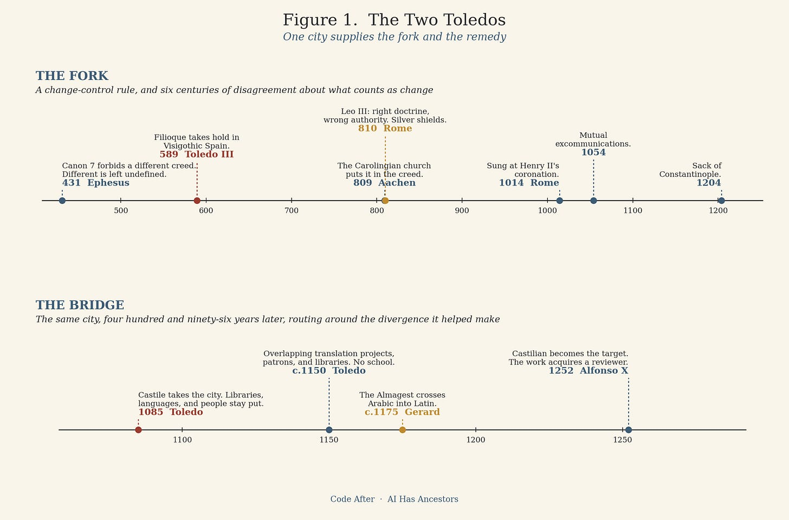
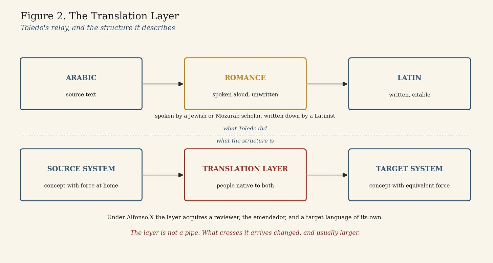
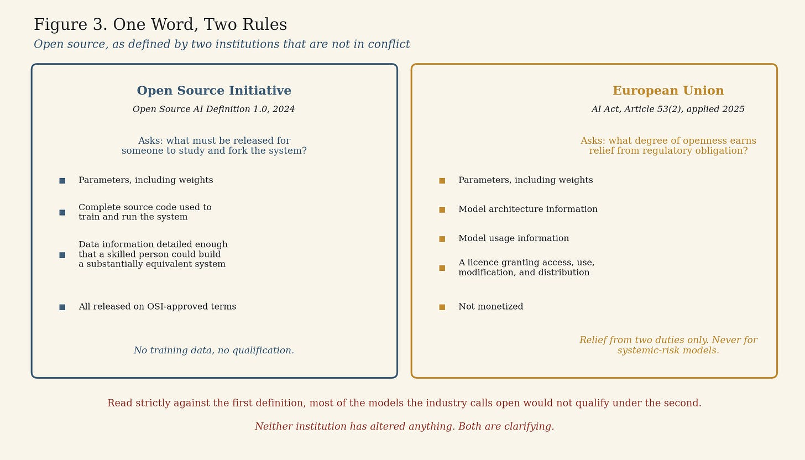

# The Two Toledos

Every shared standard needs a rule about who is allowed to change it. Writing that rule is the easy part. The hard part is that the rule has to define what counts as a change, and it is written by people who cannot yet imagine the alterations they are trying to prevent.

The Christian church wrote such a rule in 431 and spent the next six hundred years discovering what it had failed to say. The city where the failure became visible was Toledo. Four hundred and ninety-six years later, the same city became the place where Latin Europe reconnected to knowledge it had lost, by building a machinery for moving ideas between systems that had stopped speaking to each other.

One city, both stories. That is not a coincidence worth noting. It is the argument.

## The rule that did not define its own terms

The Council of Ephesus met in 431 to settle a dispute about the person of Christ. Among its acts, after reading a statement of faith submitted by a presbyter named Charisius, the synod decreed that it was unlawful for anyone to bring forward, write, or compose a different faith as a rival to the one established at Nicaea.

Read that as a governance clause and it is competent drafting. It names the protected object, prohibits the substitution of a rival, and attaches penalties by rank. Bishops and clergy face deposition, laity anathema.

Read it as a governance clause and it is also incomplete in two ways that matter more than anything it says.

It does not define difference. It forbids a different faith without stating the test by which a later reader distinguishes a different creed from a clearer statement of the same one. Every standard that permits clarification and forbids alteration eventually discovers that the two are the same act observed from opposite ends.

It does not fix its own object. Ephesus refers to the faith established at Nicaea, which is the creed of 325. The text that later became the common liturgical standard across the Christian world was the fuller creed associated with Constantinople in 381. Which of the two the canon protects was never specified, because in 431 nobody needed to ask.

A rule existed. The rule contained no interpreter and no definition of its central term. Anyone who has watched a technical standard acquire a governance body afterward, and watched that body spend years litigating the meaning of words the original drafters used casually, recognizes the shape.

## Toledo, 589

In sixth-century Spain the Visigothic ruling class was moving from Arian Christianity to Nicene Christianity. Arianism subordinated the Son to the Father. Any formulation that emphasized the full divinity of the Son did useful work in that setting, and one formulation did it economically.

The creed of 381 says the Holy Spirit proceeds from the Father. Western theology had been speaking of the Spirit as proceeding from the Father and the Son. _Filioque_. Three syllables, one word, a local answer to a local problem.

The Third Council of Toledo met in 589 as King Reccared and his kingdom formally entered Nicene Christianity. The popular account says the council inserted the word into the creed and thereby split Christendom. The manuscript evidence does not support anything that clean, and current scholarship treats the flat attribution to Toledo III as too simple, placing the decisive creedal addition later, with the Carolingians.

The correction improves the story rather than weakening it. There was no editing session. There was a useful regional variant that acquired users, and then acquired users who had never known any other version, and then acquired institutions built on the assumption that it was the version.

Standards do not fork when someone announces a fork. They fork when a local solution accumulates enough practice around itself that reversing it stops being a textual question and becomes an institutional one.

## Right doctrine, wrong authority

By the late eighth century the formulation had moved north and hardened. Frankish monks in Jerusalem, singing the creed with the addition, were challenged by Greek monks who did not recognize the text. Charlemagne’s theologians defended the Frankish version. A council at Aachen affirmed it in 809.

Charlemagne then sent a delegation to Rome, and in 810 Pope Leo III did something that has almost no modern equivalent in a world that treats being right as sufficient warrant to act.

Leo agreed with the theology. He affirmed that the Spirit proceeds from the Father and the Son, and approved the formulation for teaching and for personal professions of faith. Then he refused to put it in the creed, on the ground that the fathers who settled the text at Constantinople were no less inspired than the bishops who had met at Aachen, and that a later council held no standing to rewrite what an earlier one had fixed. He advised the Frankish court to stop singing it, in order to avoid scandal.

To place the refusal beyond later argument, according to the _Liber Pontificalis_, Leo had two heavy silver shields made, carrying the creed of 381 in Greek and in Latin, without the addition, and displayed them in Saint Peter’s. The Latin inscription records that he placed them there for love and protection of the orthodox faith.

A pope who agreed with the substance and rejected the edit, and who then cast the unamended text in metal, is the cleanest statement of a distinction most institutions never manage to make. Being right about the content of a change confers no authority to make it. The two questions are separate, and the second one is the one that governs.

The shields did not hold. The Frankish churches went on using the addition. Rome went on resisting it. Then in 1014, at the papal mass surrounding the imperial coronation of Henry II, Rome sang the creed with _filioque_.

Two centuries after Leo, the edit acquired papal sanction. Adoption had run ahead of authorization, and authorization eventually moved to where adoption already was. That is the mechanism, and it is worth stating without decoration: standards get settled by use before they get settled by rule, and the institution arrives afterward to ratify what already exists.

## Forks are recognized long after they are taken

The year 1054 carries the label of the schism, and the mutual excommunications of that year were real. So was the _filioque_. So was a far larger dispute about the authority of the bishop of Rome against the authority of ecumenical councils. Historians now treat the separation as a long process rather than a dated event, and the two issues that remain most recognizable from that period are precisely the word and the question of who holds standing to settle it.

Nobody alive in 1054 understood that they were watching the beginning of a thousand-year separation. What made it permanent was not a council. In 1204 a Western crusade captured and sacked Constantinople and installed a Latin regime in the city. After that, theological divergence had blood and property attached to it, and memory of a kind that outlasts arguments.

By the time the incompatibility was obvious, each side had centuries of language, authority, liturgy, and political identity built around its own version. Forks are recognized long after they are taken. The recognition arrives at the point where something has to cross and cannot.

That is the first Toledo. The second begins after the city itself changed systems.

## Toledo, 1085

Alfonso VI took Toledo from its Muslim ruler in 1085. Political authority changed hands. The city’s linguistic inheritance did not leave with it.

Toledo remained populated by Christians, Muslims, and Jews, including Arabic-speaking Christians later called Mozarabs. Arabic went on functioning in the documentary and social life of the city under Christian rule. Northern clerical and aristocratic elites arrived into a population that was already operating across languages, legal traditions, and scholarly systems. The libraries stayed. The people who could read them stayed.

That combination made Toledo unusual, and within two generations it made the city one of the most important places in Western Europe for moving scientific and philosophical work out of Arabic and into Latin.

The phrase “Toledo School of Translators” oversells what existed. There was no faculty, no curriculum, no admissions, no payroll. Lynn Thorndike put it bluntly: there was never such a school in Toledo, not even under Alfonso X. Anthony Pym traced the label to two nineteenth-century historians, and specifically to Amable Jourdain, who in 1819 assembled two translators’ prefaces addressed to an archbishop of Toledo into the appearance of an institution. Charles Burnett, reassessing the twelfth-century work, describes distinct programs rather than one operation, with the two principal translators, Gerard of Cremona and Dominicus Gundissalinus, concentrating on different fields.

The correction makes Toledo more interesting rather than less. It was not an institution. It was a node. People went there because the manuscripts, the languages, and the human beings capable of moving between them were in the same place at the same time, under patrons willing to fund the work.

Gerard of Cremona is the case in point. He came from northern Italy with a problem rather than a job. He wanted to read Ptolemy’s _Almagest_, and no usable Latin version existed. In Toledo the work existed in Arabic. So he learned Arabic, and spent most of the rest of his life translating. The list his students compiled after his death, the _Commemoratio librorum_, records more than seventy works across astronomy, medicine, mathematics, and philosophy. His _Almagest_, finished around 1175, is the version through which Ptolemaic astronomy reached later European work.

## The relay

There was no single Toledo method. Gerard read Arabic himself and worked directly. Other collaborations, documented in the sources, used an intermediate stage, and that stage is the most instructive thing in the whole episode.

An Arabic-speaking Jew or Mozarab read the Arabic and rendered it aloud in the local Romance vernacular. A Latinist listened and constructed the Latin text from what he heard. Arabic to Romance to Latin, with the middle stage spoken and never written down.

By modern standards this is inefficient to the point of absurdity. It worked because each participant held something the other lacked. One understood the source language and the world the text came out of. The other knew what a sentence had to look like to function as authority inside Latin scholarship. The spoken middle language was where the handoff happened, and it existed precisely because neither man could do the whole job.

Under Alfonso X, from 1252, the work changed shape again. Castilian rather than Latin became an important target language, and the process acquired roles: translators, glossators, and the _emendador_, the corrector who reviewed the finished result. The king took part in the final editorial stage on some projects.

At that point translation had stopped being bilingual substitution and become infrastructure. It had a target format, a review function, a terminology practice, and someone accountable for the output.

## What actually crossed

It is tempting to describe all of this as the recovery of lost Greek learning, as though Latin Europe had restored a backup. That description understates what happened and gets the mechanism wrong.

Greek works had entered Arabic centuries earlier, and the Arabic intellectual world had not merely stored them. It had read them, corrected them, argued with them, and built new mathematics, astronomy, medicine, and philosophy around them. What crossed into Latin at Toledo was Greek thought together with centuries of work performed on it in Arabic, which is why the names that arrive in the Latin universities include al-Khwārizmī, Avicenna, and Averroes alongside Aristotle, Galen, and Ptolemy.

A translation layer is not a pipe. The people inside it decide which concepts correspond, invent vocabulary where no equivalent exists, and judge what has to stay fixed and what has to be transformed in order to carry equivalent force at the other end. Those are constitutive decisions. What comes out the far side is not what went in, and in the Toledo case it was considerably more.

The city associated with one of Christianity’s most durable standards disputes became, six centuries later, the infrastructure through which knowledge moved across systems that no longer shared a standard at all.

## We are writing creeds again

The definitions being written around artificial intelligence today are presented as technical and operate as constitutional. What counts as an open model. What counts as frontier. What constitutes meaningful human oversight. When an agent has acted rather than recommended. Who authors an AI-assisted output. When training becomes use. What provenance has to prove, and what rights travel with weights.

Every one of those definitions allocates responsibility and moves capital. Every one of them will be defended by whoever writes it on the ground that they are clarifying what was already meant. They will be right, in the way the Carolingians were right, and the argument will not be resolvable from inside the standard.

The clearest live example needs no geopolitics at all. Take one phrase, and two institutions that are not adversaries.

The Open Source Initiative published its Open Source AI Definition in October 2024. To qualify, a system must be released in the preferred form for making modifications, which the definition specifies as three things: the parameters including weights, the complete source code used to train and run the system, and data information detailed enough that a skilled person could build a substantially equivalent system.

The European Union’s AI Act uses the same vocabulary for a different purpose. Article 53(2) grants a general-purpose model relief from certain obligations where the model is released under a free and open-source licence permitting access, use, modification, and distribution, where the parameters including weights, the architecture information, and the model usage information are publicly available, and where the model is not monetized. The relief covers two duties: technical documentation, and the information supplied to downstream providers. It does not touch the copyright policy obligation or the requirement to publish a summary of training content, and it is unavailable to models classified as carrying systemic risk. The Commission’s 2025 guidelines add that all four licence rights must hold, while permitting some safety-oriented usage restrictions.

Neither institution has altered anything. Both are clarifying. But they are answering different questions, and the answers do not line up. The Initiative is asking what has to be released for someone to study and fork the system. The Union is asking what degree of openness earns relief from regulatory obligation. Training data is load-bearing in the first and absent from the second.

The consequence is concrete rather than academic. Read the European provision strictly against the American definition, and most of the models the industry routinely calls open would fail to qualify, because their training data is not disclosed. Read it loosely as open-weight, and highly capable systems pass through a gate that was built for something else.

That is the _filioque_ problem, running now, between two bodies with no quarrel. Interoperability fails most quietly where two systems use the same word for different rules, because nobody registers a disagreement until something has to cross.

Having the vocabulary is not having the standard.

## The part that outlasts the capability race

Capability is converging. Stanford’s index puts the gap between the leading American and Chinese models at 2.7 points, down from a spread of seventeen and a half to thirty-one and a half points three years ago. Weights that perform the same task can sit inside institutional wrappers that disagree about where data lives, what a licence permits, how a model is audited, what crosses a border, what an autonomous agent can authorize, and where responsibility attaches when something fails.

A benchmark measures the model. Nothing measures the distance between the institutions around the model, which is the distance that determines whether anything can move.

Toledo suggests where that capacity comes from, and it is not from goodwill at either end. The city could translate because it contained people who were native to both systems and beholden to neither, working under patrons who paid for the output. No amount of agreement between the parties substitutes for that. Interoperability is not built by the systems. It is built by the people standing between them.

Today the intermediate language is a contract, an audit schema, a licensing standard, a certification, an interface specification, or a professional rule. The scarce person is not bilingual. The scarce person is bi-systemic: someone who knows what a concept means on one side, which institution gives it force there, and what it has to become to carry equivalent force on the other.

## Institutions keep the solution

There is a last lesson in the first Toledo, and it is the one most likely to apply to work being done this year.

Arianism, the problem the formulation was built to answer, faded. The formulation stayed. It acquired new functions inside a conflict between Rome, Constantinople, and the Frankish world that nobody in Visigothic Spain was attempting to settle, and it was still doing institutional work eight centuries later.

Institutions preserve solutions long after they have forgotten the problems that produced them. Rules acquire constituencies. Contracts inherit language. Compliance systems build forms around definitions, and capital is invested around the architecture that results. Eventually the reason a rule exists matters less than everything standing on top of it.

Export controls written around one hardware bottleneck will outlive the bottleneck. Disclosure rules designed for a person typing prompts will be inherited by systems acting on their own. Licensing concepts drafted around one architecture will govern architectures nobody has built. None of that argues against writing the rules. It argues that change control is the part to get right, and that when change control fails, the ability to translate is what remains.

## The two Toledos

The first Toledo shows how a shared standard forks. A local formulation solved a local problem, spread, and acquired political weight. A pope agreed with the substance, refused the authority to alter the text, and cast the unamended version in silver. Two centuries later the institution that had refused adopted it anyway, because the installed base had moved and authorization followed. By the time anyone called it a separation, the separation was old.

The second Toledo shows what remains available afterward. Systems that had stopped sharing a standard did not merge, and nobody asked them to. People who lived inside both built a layer between them, and what crossed that layer arrived changed and larger than it started.

Six centuries. One city. Two questions, and the second one now matters more than the first.

Not who gets to edit the creed. Whether anyone is still able to translate it.

---

## Sources

**Ephesus and the change-control rule.** Council of Ephesus (431), decree of the sixth session, commonly numbered Canon 7. Greek text and English translation in Philip Schaff, ed., _Nicene and Post-Nicene Fathers_, second series, vol. 14, _The Seven Ecumenical Councils_; Latin and English in Norman Tanner, ed., _Decrees of the Ecumenical Councils_, vol. 1. The canon’s silence on whether it protects the creed of 325 or that of 381 is noted in the standard commentaries and is the substance of the ambiguity described above.

**Filioque, Aachen, and Leo III.** North American Orthodox-Catholic Theological Consultation, _The Filioque: A Church-Dividing Issue? An Agreed Statement_, Saint Paul’s College, Washington, D.C., October 2003, for the 809 council at Aachen, the 810 delegation to Rome, and Leo III’s position: orthodoxy of the term affirmed, use in catechesis and personal professions approved, inclusion in the creed of 381 refused on the ground that the fathers of that council were no less inspired. _Liber Pontificalis_, life of Leo III, for the two silver shields in Greek and Latin displayed in Saint Peter’s. Leo’s own statement of the doctrine appears at _Patrologia Latina_ 102, columns 1030–1031.

**1014 and the long separation.** The first papal use of the creed with the addition is placed at the imperial coronation of Henry II in 1014. On 1054 and 1204, current scholarship treats the East-West separation as a process rather than a dated rupture, with the Fourth Crusade’s capture and sack of Constantinople in 1204 doing more to make it permanent than any conciliar act.

**Toledo after 1085.** On the historiography of the “school”: Lynn Thorndike, _A History of Magic and Experimental Science_, for the judgment that no such school existed, including under Alfonso X; Anthony Pym, “Twelfth-Century Toledo and Strategies of the Literalist Trojan Horse,” _Target_ 6:1 (1994), tracing the label to nineteenth-century historians and to Amable Jourdain’s 1819 assembly of two translators’ prefaces; Charles Burnett, “The Coherence of the Arabic-Latin Translation Programme in Toledo in the Twelfth Century,” _Science in Context_ 14 (2001), for distinct programs under Gerard of Cremona and Dominicus Gundissalinus, and for the new edition of the _Vita_, _Commemoratio librorum_, and _Eulogium_ compiled by Gerard’s students. On Gerard’s translations, see also Michael McVaugh’s translation of the _Commemoratio_ in Edward Grant, ed., _A Source Book in Medieval Science_ (1974). The Arabic-to-Romance-to-Latin relay is documented for particular collaborations rather than as a universal workflow; the _emendador_ and the shift to Castilian belong to the Alfonsine period from 1252.

**Open source, two definitions.** Open Source Initiative, _The Open Source AI Definition 1.0_ (October 2024), for the preferred form of making modifications and its three required elements. Regulation (EU) 2024/1689 (Artificial Intelligence Act), Article 53(2) and recitals 102 to 104, for the open-source conditions and the scope of the exemption; European Commission, _Guidelines on the scope of the obligations for general-purpose AI models_ (July 2025), for the requirement that all four licence rights hold and for permitted safety-oriented restrictions. General-purpose AI obligations applied from 2 August 2025.

**Model convergence.** Stanford HAI, _AI Index 2026_, for the 2.7-point gap between leading American and Chinese models and the earlier spread of 17.5 to 31.6 points.