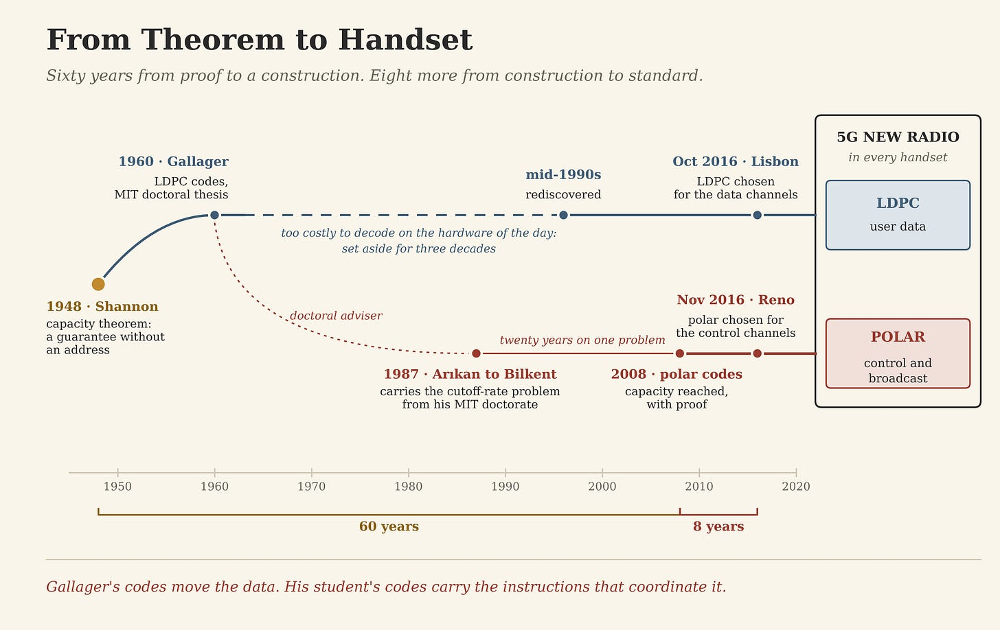
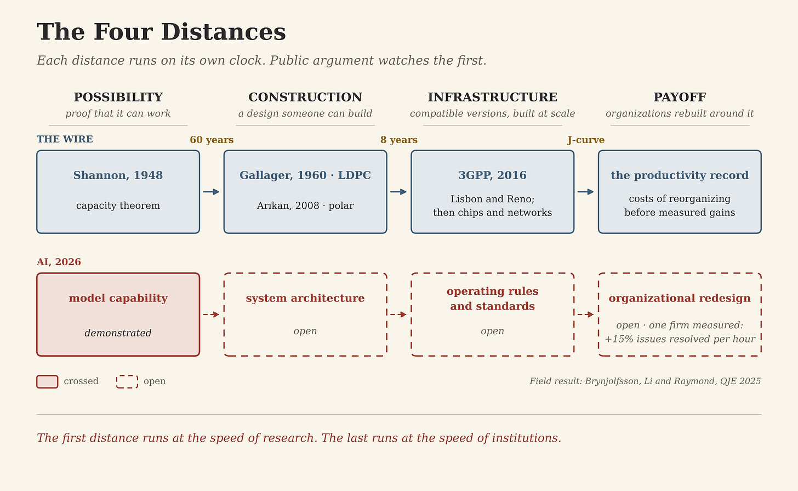
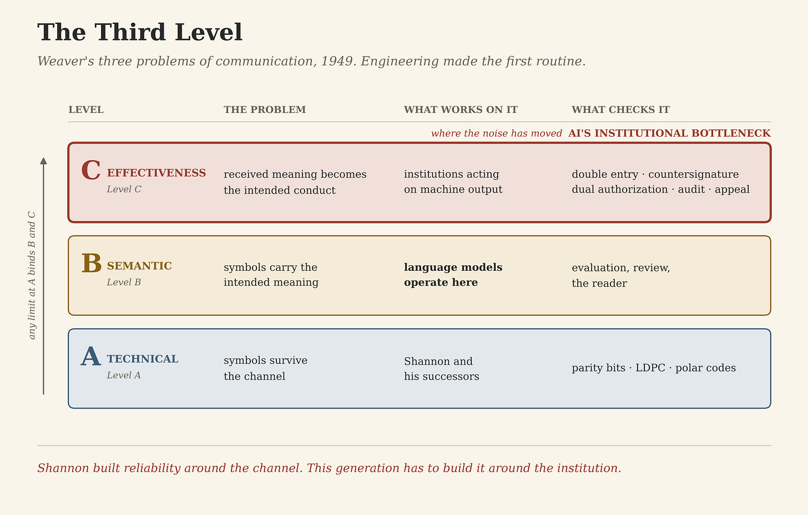

# A Theorem Is Not Infrastructure

>_Claude Shannon proved in 1948 that reliable communication over a noisy channel was possible. Sixty years later Erdal Arıkan published a construction tied directly to that proof, and eight years after that an industry agreed to build it. This essay reads the wire, the fourth member of the family, for what it says about the fifth: the distance between proving a thing possible and building institutions that can rely on it. The full framework and the Code After Series are at codeafter.ai._

In 1948 Claude Shannon showed that every noisy communication channel has a capacity, a maximum rate at which information can cross it reliably. Below that rate, a good enough code can push the probability of error as close to zero as anyone wants. Above it, no code can.

The theorem told engineers that reliable digital communication was possible. How to build it was another question. Shannon’s proof worked by averaging over codes chosen at random and showing that good ones had to exist, without naming a single code an engineer could implement. It was a guarantee without an address.

Sixty years later Erdal Arıkan, a professor at Bilkent University in Ankara, published an address: the first explicit construction proven to reach capacity for a broad class of channels, with encoding and decoding cheap enough to run. Eight years after that, the body that writes the world’s mobile standards chose his codes to carry the control information of 5G.

The road between those dates ran through mathematics, decades of competing codes, simulation campaigns, standards meetings and an industry’s retooling. Past the end of it lay another distance, between a standard installed everywhere and an economy that profits from it. AI is on a comparable road. Public argument crowds around the first milestone, what the models can do, and treats the later ones as though they will arrive on their own.

## The cut

Shannon had a habit of cutting a hard problem along its seams and solving one piece completely.

He did it first as a student. His master’s thesis at MIT, published in 1938 as _A Symbolic Analysis of Relay and Switching Circuits_, showed that the algebra of logic could describe, and simplify, networks of relays and switches. Logic became wiring. The relays are long gone. The abstraction sits inside every digital circuit designed since.

He made the larger cut in 1948. The opening page of _A Mathematical Theory of Communication_ concedes that messages frequently carry meaning, then sets meaning aside: those semantic aspects, Shannon wrote, are “irrelevant to the engineering problem.” With meaning bracketed, information became a quantity a machine could count, compress, encode and protect without knowing whether the message was true, wise or understood. The exclusion was a method.

A year later Warren Weaver laid the cut out in full. Communication, he proposed, poses problems at three levels. Level A is technical: how accurately the symbols can be transmitted. Level B is semantic: how precisely the transmitted symbols convey the intended meaning. Level C is effectiveness: whether the received meaning goes on to “affect conduct in the desired way.” Shannon’s mathematics lived entirely at Level A. Weaver argued that the levels were less separate than they looked, because any limit discovered at Level A binds the other two. Meaning and conduct travel only on the symbols the channel delivers.

In 1955 Shannon put his name, with John McCarthy, Marvin Minsky and Nathaniel Rochester, to the proposal for the Dartmouth Summer Research Project on Artificial Intelligence. The engineer who had set meaning aside so that one problem would yield to mathematics helped launch the field that has spent seventy years trying to mechanize the levels he left out. In this series’ family of encoding technologies, that places Shannon in two generations at once. He wrote the founding mathematics of the wire, and he signed the founding document of the fifth member.

Keep Weaver’s three levels in view. They return at the end.

## The road

The sixty years after Shannon were not empty. Hamming codes, Reed–Solomon codes and convolutional codes carried real systems for decades, from deep-space probes to compact discs. In 1993 turbo codes came closer to Shannon’s limit in practice than anything before them.

A second route had been found much earlier and then mislaid. Robert Gallager described low-density parity-check codes in his MIT doctoral thesis in 1960. The mathematics was sound and the decoding was too expensive for the computers of the day, so the codes were largely forgotten for three decades and rediscovered in the mid-1990s, when hardware had caught up. The idea had not changed. The price of computing had.

Gallager also supervised the doctorate of a young engineer from Turkey, Erdal Arıkan, who had come to MIT by way of Caltech. Arıkan’s thesis was on sequential decoding, a method for decoding convolutional codes that runs into a practical ceiling called the cutoff rate. Below it the decoder works. Above it, the work the decoder has to do grows without bound, and the cutoff rate sits below Shannon’s capacity. Whether that ceiling could be pushed toward capacity was a question most of the field stopped asking once Viterbi decoding displaced sequential decoding in most applications. Arıkan kept asking it.

After a short appointment as an assistant professor at the University of Illinois, he returned to Turkey in 1987 to join Bilkent University, then newly founded. By his own published account, the cutoff rate never let him go. In a 2016 paper on the origin of polar coding, he describes the effort to boost it as a central theme of his research across the years, and he states that polar coding was conceived as a technique for doing exactly that. The polar code was designed as the inner layer of a larger scheme. It worked so well that the outer layer was never needed.

That move to Ankara has acquired a political afterlife. In 2022 Graham Allison and Eric Schmidt made Arıkan the cautionary case for an American “million talents” program, writing that he went home because he could find neither an academic appointment nor funding in the United States. The record is less tidy. He held an American academic appointment before he left, and the polar paper appeared twenty-one years after he did. In 1987 nobody was choosing between Urbana and Ankara on the strength of a code that would not exist for two decades. Whether the same idea would have arrived in Illinois, or arrived at all, is a counterfactual nobody can run.

What the episode does establish is the shape of the path. A thesis adviser, a thesis problem the field was leaving behind, a short American appointment, a young university willing to keep one researcher on one problem for twenty years: none of these appears in the 2009 paper, and each helped decide that the paper would be written, and where.

The paper appeared on arXiv in July 2008 and in the _IEEE Transactions on Information Theory_ a year later. Its central idea is channel polarization. Take many copies of a noisy binary channel and combine them recursively, and the synthetic channels that result begin to separate. Almost all of them end up either nearly perfect or nearly useless, and the share that ends up nearly perfect approaches the capacity of the original channel. Send the information through the good ones. Freeze the rest at values both ends agree in advance.

Arıkan proved that for any binary-input memoryless channel the construction reaches the channel’s symmetric capacity as the block length grows, with encoding and decoding that cost on the order of N log N operations for a block of N bits. Turbo and LDPC codes had approached the frontier impressively in practice. Arıkan gave the field a different kind of object, an explicit construction that carried its own capacity proof. Shannon had established that the destination existed. Arıkan drew a map to it.

Shannon died in 2001 and did not see the map. The IEEE Information Theory Society later gave Arıkan the award that carries Shannon’s name.

## The standard

A map still has to become a road millions of people can drive on. Between the paper and commercial 5G, polar codes had to survive a selection process run by competitors. Through most of 2016 the radio working group of 3GPP evaluated candidate codes for the new system: turbo codes, the incumbent from 4G; LDPC codes; and polar codes, championed above all by Huawei, whose engineers had spent years turning Arıkan’s construction into something a chip could run.

The decisions came at two meetings a month apart. In October 2016, in Lisbon, the group adopted LDPC codes for the data channels. In November, in Reno, it adopted polar codes for the control channels. The 5G New Radio specification as built carries both. LDPC codes move the user data. Polar codes carry the broadcast channel and the control information that schedules the data and reports back on it, with simpler codes reserved for the smallest uplink messages.

That leaves an improbable lineage inside every 5G handset. Gallager’s codes move the data. His student’s codes carry the instructions that coordinate it.

One idea waited three decades for hardware. The other went from preprint to standards decision in eight years. Neither moved by itself. Shannon needed mathematics. Arıkan needed a construction. The standard needed rival engineering teams, simulation campaigns, contributions argued line by line, corporate investment, compromises, and specifications precise enough that equipment from different manufacturers would work together. Then chip designers had to put the decisions into silicon and operators had to put the silicon into networks. In July 2018 Huawei’s founder, Ren Zhengfei, presented Arıkan with a medal at a ceremony in Shenzhen: a company thanking a theorist for an idea its engineers had spent years making buildable.

A theorem is not infrastructure. Infrastructure is what exists when enough institutions agree to build compatible versions of an idea, repeatedly and at scale.

## The payoff

Infrastructure leaves one more distance. A technology can be installed everywhere without changing how organizations produce value. _The Wrong Ancestor_ told that distance through the electric motor, which paid off only after factories were rebuilt around it, and through the productivity J-curve that Erik Brynjolfsson, Daniel Rock and Chad Syverson formalized in 2021: the costs of reorganizing arrive years before the measured gains. That argument stands and is not repeated here. What this essay adds is a measurement of the distance inside a single workplace.

Brynjolfsson, Danielle Li and Lindsey Raymond followed 5,172 customer-support agents at one company as an AI assistant was rolled out to them in stages. In the _Quarterly Journal of Economics_ in 2025 they report that access to the assistant raised issues resolved per hour by 15 percent on average. The gains concentrated among less experienced and lower-skilled agents, who improved in both speed and quality. The most experienced and highest-skilled agents gained little in speed and lost a little in quality.

The pattern fits a system that has absorbed part of what the best agents do and handed it to the newest. Notice what moved. Know-how traveled through software from one group of workers to another, and no balance sheet in the company recorded the transfer.

It is one firm, one occupation and one system. That narrowness is the useful part. A model can produce a gain inside one workflow in months. An economy-wide gain requires thousands of organizations to find where such systems work, redesign the work around them, rewrite incentives, retrain people, rebuild software and decide what machines are allowed to decide. That clock runs at the speed of institutions.

## The third level

Return to Weaver. Three-quarters of a century of engineering have made Level A so routine that ordinary users never see it. Messages cross fiber, radio and oceans wrapped in layers of correction built on the assumption that every physical channel is imperfect. Language models now operate every day on the material of Level B. They summarize, translate, draft, code and answer, and what they produce presents itself as meaningful, competent language. Whether that amounts to understanding is a question this essay leaves to others.

Level C cannot be left to others. Weaver’s third problem was whether received meaning changes conduct in the desired way, and inside an institution conduct is concrete. A payment is released. A claim is denied. A filing is signed. A shipment leaves the warehouse. A prescription is written. At that point machine output stops being language and becomes action, and that is where the noise has moved.

Models err. Context is incomplete. Instructions conflict. Records are stale. The people around a system want different things. A correct answer can still come from something with no authority to act on it. Inside an institution an action has to be more than accurate. It has to be attributable, reviewable and legitimate enough to stand when someone challenges it.

Shannon’s insight about noise was that a reliable system does not need a noiseless channel. It needs structure built around the noise. Institutions found their own version of that principle centuries before information theory.

In 1494 Luca Pacioli published in Venice the first printed account of double-entry bookkeeping. He was recording a method Italian merchants had used for more than a century, and his book carried it across Europe. Every transaction is entered twice, as a debit in one account and a credit in another. The redundancy is deliberate. When the books fail to balance, certain classes of error announce themselves. A trial balance is an institutional parity check.

The check proves less than it appears to. A transaction left out entirely leaves the books in balance, and so does an entry posted consistently to the wrong accounts. Audit and the other controls exist because the simple check cannot catch everything. What the ledger guarantees is narrower than truth and more useful: particular departures from the expected structure become visible enough to investigate and repair.

Law built its own versions: the witnessed deed, the countersignature, the separation of powers, appellate review. Organizations added dual authorization, reconciliation, audit trails and independent review. These are institutional mechanisms, and the analogy to error-correcting codes holds only as far as their shared function: redundancy, evidence and friction, added because a system acting at scale cannot assume that every message, transaction or decision is correct.

AI adds a new source of messages. For five centuries the language and form of a document told its reader roughly where it came from, as _Who Pays to Cross_ argued, and machine output carries the form without the origin. It arrives fluent, in enormous volume, with no accountable author behind it. The institutional work is to decide where provenance is required, which outputs must be tested before they count, which actions need authorization, what gets logged, when uncertainty triggers escalation, and who answers when something goes wrong. Reliable AI will depend on institutional architecture as much as on model architecture.

## How this argument fails

Put the claim in a form that can be tested. AI’s binding constraint is moving from capability to the institutional distances that follow it, and the decisive one sits at Level C, where output becomes action. Two observations would break that.

If AI produces sustained economy-wide productivity gains while firms leave their workflows, decision rights, roles and controls substantially as they were, the reorganization distance is far shorter than this essay assumes, and capability carried the load by itself.

If machine output becomes reliable enough at the point of consequential action that review, reconciliation and escalation catch little error relative to what they cost, institutional controls stop being the binding constraint, and the analogy to error correction fails exactly where it matters.

Both can be measured. Neither has been settled.

## The interval

Shannon’s theorem appeared in 1948. Gallager’s codes waited three decades for hardware. Arıkan’s construction arrived sixty years after the theorem and entered a global standard eight years after that. Each interval was filled with work that looked secondary while it was happening: constructions, chips, simulation campaigns, committee decisions, rewritten workflows, revised controls.

Each was also filled with contingency. A thesis adviser. A thesis problem the field was leaving behind. A short appointment in Illinois. A young university in Ankara willing to let one researcher spend twenty years on one problem. An inner code that made its outer code unnecessary. Two meetings, a month apart, that split one system between two families of codes. None of these appears in Shannon’s theorem, and almost none appears in the final specification. Each helped decide the path between them.

Technical history becomes inevitable only after the contingencies are edited out.

AI has answered its first question: machines can do useful symbolic work at scale. The later questions belong to engineers, standards bodies, managers, accountants, lawyers, regulators and courts, and their answers will set how fast capability becomes consequence, where the value settles and which mistakes stay recoverable.

Reliability has always been built. Shannon’s generation built it around the channel, so that symbols could survive noise. This generation has to build it around the institution, so that machine-generated meaning can survive contact with judgment, authority and action.

The interval is the window. The interval is also the work.

---

## Sources

**Shannon.** C. E. Shannon, “A Symbolic Analysis of Relay and Switching Circuits,” _Transactions of the American Institute of Electrical Engineers_ 57 (1938): 713–723, from his MIT master’s thesis. C. E. Shannon, “A Mathematical Theory of Communication,” _Bell System Technical Journal_ 27 (July and October 1948): 379–423 and 623–656; the semantic aspects of communication are “irrelevant to the engineering problem” on the opening page. The coding theorem is proved by a random-coding argument that establishes the existence of good codes without constructing one. Shannon died on 24 February 2001.

**Weaver.** W. Weaver, “Recent Contributions to the Mathematical Theory of Communication,” in C. E. Shannon and W. Weaver, _The Mathematical Theory of Communication_ (Urbana: University of Illinois Press, 1949). Levels A (technical), B (semantic) and C (effectiveness), with Level C framed as whether the received meaning affects “conduct in the desired way.” Weaver’s argument that limitations found at Level A necessarily apply to Levels B and C.

**Dartmouth.** J. McCarthy, M. L. Minsky, N. Rochester and C. E. Shannon, “A Proposal for the Dartmouth Summer Research Project on Artificial Intelligence,” 31 August 1955.

**Coding before polar codes.** R. W. Hamming, “Error Detecting and Error Correcting Codes,” _Bell System Technical Journal_ 29 (1950). I. S. Reed and G. Solomon, “Polynomial Codes over Certain Finite Fields,” _Journal of the Society for Industrial and Applied Mathematics_ 8 (1960). P. Elias, “Coding for Noisy Channels” (1955), on convolutional codes. C. Berrou, A. Glavieux and P. Thitimajshima, “Near Shannon Limit Error-Correcting Coding and Decoding: Turbo-Codes,” _Proceedings of ICC_ (1993). R. G. Gallager, _Low-Density Parity-Check Codes_, MIT Sc.D. thesis (1960), published as a monograph by MIT Press (1963). D. J. C. MacKay and R. M. Neal, “Near Shannon Limit Performance of Low Density Parity Check Codes,” _Electronics Letters_ (1996), on the rediscovery.

**Arıkan.** B.S., California Institute of Technology; M.S. and Ph.D., MIT, with Robert G. Gallager as doctoral adviser and a doctoral thesis on sequential decoding for multiple-access channels; tenure-track assistant professor, University of Illinois at Urbana-Champaign; Bilkent University from 1987 (Bilkent University biography; IEEE Information Theory Society biography). E. Arıkan, “Channel Polarization: A Method for Constructing Capacity-Achieving Codes for Symmetric Binary-Input Memoryless Channels,” _IEEE Transactions on Information Theory_ 55, no. 7 (July 2009): 3051–3073, DOI 10.1109/TIT.2009.2021379; preprint arXiv:0807.3917, submitted 24 July 2008. E. Arıkan, “On the Origin of Polar Coding,” _IEEE Journal on Selected Areas in Communications_ 34, no. 2 (2016), stating that polar coding was conceived as a technique for boosting the cutoff rate of sequential decoding, that the problem dates from his doctoral work in the 1980s and remained a central theme of his research, and that the polar inner code proved effective enough that no outer code was needed. IEEE Richard W. Hamming Medal (2018). IEEE Information Theory Society Claude E. Shannon Award.

**Allison and Schmidt.** G. Allison and E. Schmidt, “The U.S. Needs a Million Talents Program to Retain Technology Leadership,” _Foreign Policy_, 16 July 2022, also published by the Belfer Center. The essay reports their claim that Arıkan returned to Turkey because he could find neither an academic appointment nor funding in the United States, and sets it against the biographical record above. It makes no claim about Arıkan’s personal reasons for returning.

**5G New Radio.** 3GPP TSG RAN WG1 study item on NR channel coding, April to November 2016. RAN1 #86bis, Lisbon, October 2016: LDPC adopted for eMBB data channels. RAN1 #87, Reno, November 2016: polar codes adopted for eMBB uplink and downlink control channels. 3GPP TS 38.212: LDPC for the shared data channels; polar codes for the broadcast channel, downlink control information and uplink control information of 12 bits and above; repetition, simplex and Reed–Muller codes for uplink control information of 1 to 11 bits. Z. B. Kaykac Egilmez, L. Xiang, R. G. Maunder and L. Hanzo, “The Development, Operation and Performance of the 5G Polar Codes,” _IEEE Communications Surveys & Tutorials_ 22, no. 1 (2020). Huawei ceremony in Shenzhen, July 2018, at which Ren Zhengfei presented Arıkan with a medal: S. Levy, “Huawei, 5G, and the Man Who Conquered Noise,” _WIRED_, 16 November 2020.

**Productivity.** E. Brynjolfsson, D. Li and L. Raymond, “Generative AI at Work,” _Quarterly Journal of Economics_ 140, no. 2 (2025): 889–942, DOI 10.1093/qje/qjae044: 5,172 customer-support agents; a 15 percent average increase in issues resolved per hour; gains in both speed and quality for less experienced and lower-skilled agents; small speed gains and small quality declines for the most experienced and highest-skilled. E. Brynjolfsson, D. Rock and C. Syverson, “The Productivity J-Curve: How Intangibles Complement General Purpose Technologies,” _American Economic Journal: Macroeconomics_ 13, no. 1 (2021): 333–372.

**Pacioli.** L. Pacioli, _Summa de arithmetica, geometria, proportioni et proportionalita_ (Venice, 1494), including the treatise _Particularis de computis et scripturis_, the first printed exposition of double-entry bookkeeping, describing the Venetian method already in merchant use. Surviving double-entry merchant and civic ledgers in Italy predate it by more than a century.

**Code After cross-references.** _The Wrong Ancestor_, on electrification as AI’s productive ancestor and the productivity J-curve; this essay does not re-argue it. _Who Pays to Cross_, on the provenance signal that language and infrastructure supplied for five centuries and AI removes.