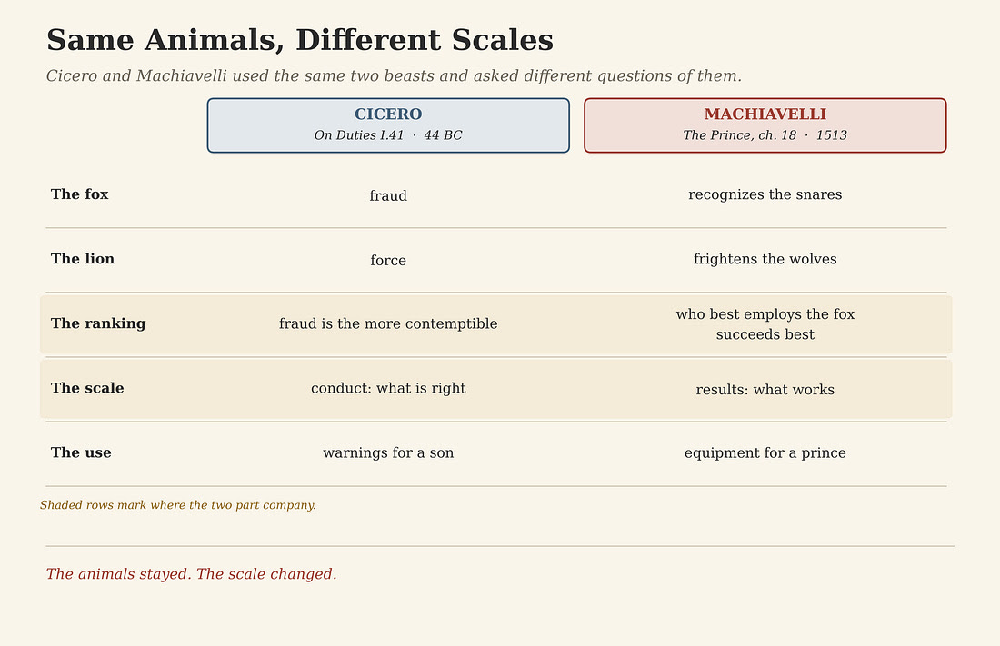
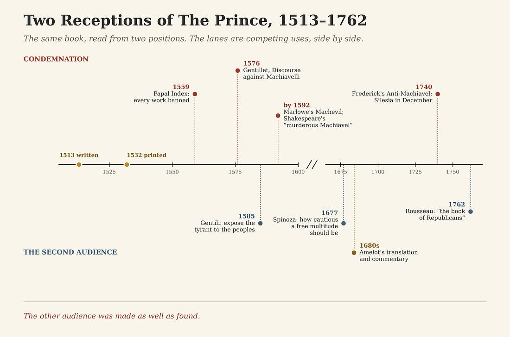
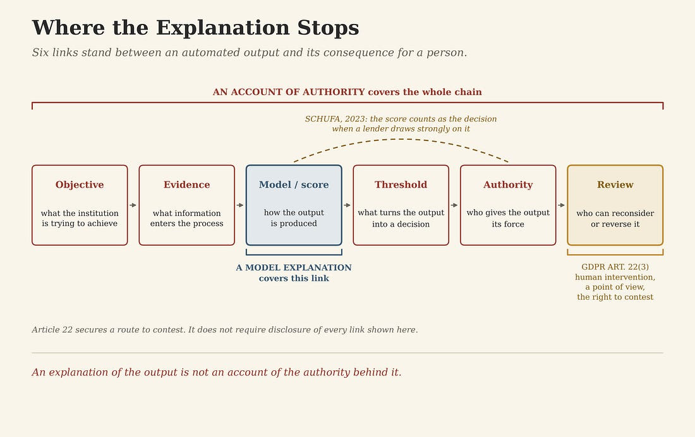

# Machiavelli's Other Audience

>_A manual of power instructs the prince and exposes him in the same pages. Which one it does depends on who reads it, and on what stands between the page and the reader. The question returns now that authority speaks through software._

Most people meet the adjective before they meet the man. Machiavellian means cunning, manipulative, ready to deceive for advantage. Niccolò Machiavelli died in Florence in 1527, and five centuries later his surname still works as a moral diagnosis. Nobody needs to have read him to use it.

The reputation has a source, and the source is on the page. _The Prince_ tells a ruler not to keep his word when keeping it would turn against him and the reasons for giving it are gone. It separates cruelty used well from cruelty used badly, and used well means inflicted at one stroke, for security, and then stopped. It offers the actions of Cesare Borgia as the best precepts Machiavelli knew to give a new prince. A reader looking for a teacher of tyrants finds one.

Heroes & Villains asks two things of every compressed reputation. First, what the compression kept and why that was useful. Then, what it discarded and what the discarded part is worth now. Some thinkers lose their better half to a slogan. Machiavelli is a harder case, because the slogan is accurate about the book. What it misses is everyone else who read it.

## The fox and the lion

The animals did not begin with Machiavelli. In 44 BC Cicero wrote _On Duties_ for his son. Wrong is done in two ways, he said, by force or by fraud. Fraud belongs to the cunning fox and force to the lion. Both are wholly unworthy of man, and fraud is the more contemptible.

Machiavelli took the same pair and asked a different question of it. In chapter 18 of _The Prince_ there are two ways of contesting, by law and by force. The first is proper to men and the second to beasts, and because the first is frequently not sufficient, a prince must know how to use the beast. He should choose the fox and the lion. The lion cannot defend himself against snares and the fox cannot defend himself against wolves, so a prince must be a fox to recognize the snares and a lion to frighten the wolves. Then comes the sentence Cicero would never have written: “he who has known best how to employ the fox has succeeded best.”

Cicero ranked the animals by conduct and put fraud at the bottom. Machiavelli ranked them by results and put the fox at the top. The animals stayed. The scale changed. Cicero handed them to his son as warnings. Machiavelli handed them to a prince as equipment, and the adjective was born in that change.

## What the compression kept

The villain was assembled quickly and by named hands. In 1559 the first papal Index of Prohibited Books placed Machiavelli among the authors whose every work was banned. In 1576, four years after the St. Bartholomew’s Day massacre, the French Protestant jurist Innocent Gentillet, in exile in Geneva, published his _Discourse against Machiavelli_. It attacked the Florentine maxim by maxim as a school for tyranny and impiety, and blamed the Italians around Catherine de’ Medici for carrying it into France. A Latin edition followed in 1577. An English translation was dedicated the same year and printed in 1602, and by then the London stage had done its own work.

Christopher Marlowe opened _The Jew of Malta_ with a ghost called Machevil, who tells the audience: “I count religion but a childish toy, / And hold there is no sin but ignorance.” In _Henry VI, Part 3_, Shakespeare gives Richard of Gloucester the boast that he will “set the murderous Machiavel to school.” The scene stages Edward IV’s courtship of Elizabeth Woodville, whom he married in 1464. Machiavelli was born in 1469. The name had come loose from the man and become a type of character.

None of these carriers invented their material. _The Prince_ does recommend fraud and force, and it does so without restoring the moral guarantees Cicero had attached to prudence. Every society needs a word for the person who treats each promise as an instrument, and Machiavelli’s name supplied one. The word does honest work. Told that a rival is Machiavellian, a listener learns to read the rival’s promises twice.

What the compression discarded was the reader.

## The author of both books

Machiavelli wrote _The Prince_ out of office. From 1498 he served the Florentine republic for fourteen years as Second Chancellor, carrying its diplomacy across Italy, to the French court and to the emperor. In 1512 a Spanish army restored the Medici, the republic fell, and he was dismissed. Early in 1513 his name was found on a conspirators’ list, and he was imprisoned and tortured. Released that March, he withdrew to his farm outside Florence and wrote _The Prince_ before the year was out, hoping it would bring him back into service. The surviving dedication addresses Lorenzo de’ Medici. The book was printed in 1532, five years after his death.

In the same years he was writing the _Discourses on Livy_, a long study of republics, liberty and the orders that keep a people free. Book One, chapter 7, argues that a republic needs public accusations, a lawful way for citizens to charge the powerful, if it is to stay free. Chapter 58 takes up the old commonplace about the fickle crowd under a title that reverses it: the multitude is wiser and more constant than a prince.

Readers have argued for five centuries about which book shows the real Machiavelli. The stronger answer is both. The author of the _Discourses_ wanted republics that lasted. The author of _The Prince_ knew exactly what they were up against. Each book makes the other harder to dismiss.

## The second audience

A description of deception has a peculiar property. Written to equip the deceiver, it also shows everyone else what deception looks like. The prince reads chapter 18 as instruction. The people he governs can read the same page as a warning. Within two generations of the first printing, readers were saying so.

In 1585 Alberico Gentili, an Italian Protestant exile teaching law at Oxford, called Machiavelli a praiser of democracy and its fiercest champion. It was not his purpose, Gentili wrote, “to instruct the tyrant, but by making his secrets public, to exhibit him naked and in plain view to the wretched peoples.” In 1677 Spinoza’s posthumous _Political Treatise_ took the same reading with more care. With what design Machiavelli wrote, Spinoza said, “one can hardly be sure.” Then: “he perhaps wished to show how cautious a free multitude should be of entrusting its welfare absolutely to one man.”

Then the medium changed. In the 1680s Abraham-Nicolas Amelot de La Houssaye published a French translation of _The Prince_ in Amsterdam, with a commentary that read the book as an unveiling of the tyrannical logic of absolute power, written under Louis XIV. Jacob Soll’s _Publishing The Prince_ traces what followed. Amelot’s was the edition most widely read in France for the next hundred years. Translation, notes and commentary changed the terms on which readers met the book. Reviewing Soll, the historian Antoine Lilti put it exactly: the _Prince_ that Rousseau read was not quite the _Prince_ that Richelieu had read.

The other audience was made as well as found.

The first audience never left. In September 1740 Voltaire saw into print the _Anti-Machiavel_, a chapter-by-chapter refutation of _The Prince_ that Frederick of Prussia had written as crown prince. Frederick had become king that May. On 16 December, without a declaration of war, he sent his army into Silesia. The book records what Frederick argued as an heir. Silesia records what he did as a king.

In 1762 Rousseau gave the second reading its most quoted form in _The Social Contract_: “He professed to teach kings; but it was the people he really taught. His Prince is the book of Republicans.”

Rousseau’s sentence is an interpretation, and it settles nothing about intention. A man who dedicated the book to a Medici in hope of a post was writing, at least in part, for the Medici. What Rousseau records is a fact about readers. By his time the book had two audiences, each took from it what its position required, and the second had been helped by the editors who stood between the page and the reader.

## Seeing the snare

The republican reading has a weakness its admirers pass over. Seeing the snare does nothing to free the foot. A people that understands exactly how it is being deceived is still governed by the deceiver if it has no way to answer. Rousseau’s republicans needed more than the book. They needed assemblies, courts and the power to remove the people who governed them. Machiavelli had said as much in the _Discourses_, where a republic keeps its freedom by giving citizens a lawful way to accuse the powerful.

Knowledge changes what a reader sees. Institutions change what happens next. The second audience needed both, and only the first came bound in the book.

## The score and the bank

Authority now reaches people in forms Machiavelli never saw. One of them is a number.

In December 2023 the Court of Justice of the European Union decided a case about SCHUFA, the German credit agency. SCHUFA computes scores and lenders use them. An applicant refused a loan after a poor score asked SCHUFA for the data and the logic behind it. SCHUFA disclosed the score and the broad method and withheld the weightings as a trade secret. Its position was that it only calculated and the lender decided. The court held that producing the score is itself an automated decision under European data law when a lender draws strongly on it to establish, carry out or end a contract. Read narrowly, the court said, the rule would leave a gap in protection. The agency would owe no account of a decision it said it had not made, and the lender could not give an account of a score it had not built.

The case concerned credit scoring rather than generative AI, and its method is what carries forward. The court read the arrangement the way Machiavelli’s second audience read a prince. It set aside the stated account of who decided and traced where the decision was made.

That move turns this history into a choice institutions face now. When a model sits inside a decision about a loan, a claim or a job, the institution decides what account it owes the person on the other side. One account explains the model: which inputs moved the output, and by how much. The other explains the authority: who chose the objective, who selected the evidence, who set the threshold, who gave the output force, and who holds the power to reconsider it. An explanation of the output is not an account of the authority behind it.

European law holds part of the second account already. Article 22 of the General Data Protection Regulation gives a person the right not to be subject to a decision based solely on automated processing that has legal or similarly significant effects. Where such a decision is allowed because it is necessary for a contract or rests on explicit consent, the controller must at least give the person the right to obtain human intervention, to express a point of view and to contest the decision. Article 22 does not require the whole chain of authority to be disclosed. It does establish what the second audience lacked: a person who has read the account needs a route to act on it.

## The fox and the reader

Cicero gave the republic a moral language for condemning fraud and force. Machiavelli gave it a working description of both. A free society needs the condemnation and the description, and it needs institutions that let a reader act on what the description reveals.

The compression that made Machiavelli a villain kept his first audience and dropped his second. It was right about the book and wrong about its readers. The systems that now score, rank and refuse are built for institutions, the way _The Prince_ was written for a prince. How they are governed comes down to what the rest of us are allowed to read about them, and what we are able to do once we have read it.

Machiavelli wrote for a prince. The book also reached the people princes govern, and they read it for their own purposes. That second audience is the part of his reputation worth recovering. A republic is what lets it act on what it reads.

---

## Notes and Sources

**Primary texts**

Cicero, _De Officiis_ (On Duties) I.13.41, written 44 BC. Trans. Walter Miller, Loeb Classical Library (1913): wrong is done by force or by fraud; fraud belongs to the cunning fox, force to the lion; “both are wholly unworthy of man, but fraud is the more contemptible.”

Niccolò Machiavelli, _The Prince_, written 1513, printed 1532. Trans. W. K. Marriott (1908). Ch. 7, the actions of Cesare Borgia: “I do not know what better precepts to give a new prince than the example of his actions.” Ch. 8, cruelties well used, applied at one stroke for security and not persisted in. Ch. 18: “Therefore a wise lord cannot, nor ought he to, keep faith when such observance may be turned against him, and when the reasons that caused him to pledge it exist no longer”; two ways of contesting, by law and by force; the fox and the lion; “he who has known best how to employ the fox has succeeded best.”

Machiavelli, _Discourses on Livy_, printed 1531. Book I, ch. 7, on how necessary accusations are in a republic to maintain it in freedom; Book I, ch. 58, the multitude is wiser and more constant than a prince.

Biography: born 1469; Second Chancellor of the Florentine republic from 1498; dismissed after the Medici restoration of 1512; imprisoned and tortured early in 1513 after his name appeared on a list of conspirators, released in March; _The Prince_ written in 1513 and dedicated to Lorenzo de’ Medici; died 21 June 1527. Cary J. Nederman, “Niccolò Machiavelli,” _Stanford Encyclopedia of Philosophy_.

_Index Librorum Prohibitorum_, Rome, 1559. Machiavelli listed among authors whose works were all prohibited.

Innocent Gentillet, _Discours sur les moyens de bien gouverner … contre Nicolas Machiavel Florentin_, 1576, written in Geneva after the St. Bartholomew’s Day massacre of August 1572; Latin edition 1577. English translation by Simon Patericke, dedicated 1577, printed in London 1602 and 1608.

Christopher Marlowe, _The Jew of Malta_, prologue spoken by Machevil; on the London stage by 1592. William Shakespeare, _Henry VI, Part 3_, III.ii (”And set the murderous Machiavel to school”); known on the London stage by 1592. Edward IV married Elizabeth Woodville in 1464.

Alberico Gentili, _De legationibus libri tres_ (London, 1585), III.9: “Machiavellus … democratiae laudator et assertor acerrimus … tyranno non favet; sui propositi non est tyrannum instruere, sed arcanis eius palam factis ipsum miseris populis nudum et conspicuum exhibere.” Latin as quoted in Pierre Bayle, _Dictionnaire historique et critique_, art. “Machiavel,” note O. English translation by Code After. See also Maurizio Viroli, _Machiavelli_ (Oxford University Press, 1998).

Baruch Spinoza, _Tractatus Politicus_ V.7, published posthumously 1677. Trans. R. H. M. Elwes (1883): “with what design one can hardly be sure”; “he perhaps wished to show how cautious a free multitude should be of entrusting its welfare absolutely to one man.”

Abraham-Nicolas Amelot de La Houssaye, _Le Prince de Nicolas Machiavel_, translated with commentary, Amsterdam: Henry Wetstein. Soll gives 1684 for the edition; Wetstein printings dated 1683 are also recorded, so the body gives the decade.

Frederick II of Prussia, _Anti-Machiavel_, revised and seen into print by Voltaire, September 1740. Frederick succeeded to the throne on 31 May 1740 and moved his troops into Silesia without a declaration of war on 16 December 1740.

Jean-Jacques Rousseau, _The Social Contract_ (1762), Book III, ch. 6. Trans. G. D. H. Cole: “He professed to teach kings; but it was the people he really taught. His Prince is the book of Republicans.”

Court of Justice of the European Union, Case C-634/21, _SCHUFA Holding (Scoring)_, judgment of 7 December 2023. The automated establishment of a probability value by a credit agency is an automated individual decision under Article 22(1) where a third party draws strongly on it to establish, implement or terminate a contractual relationship; a narrower reading would risk circumventing Article 22 and leave a lacuna in protection.

Regulation (EU) 2016/679, General Data Protection Regulation, Article 22(1), (2) and (3).

**Secondary literature**

Jacob Soll, _Publishing The Prince: History, Reading, and the Birth of Political Criticism_ (University of Michigan Press, 2005). Amelot’s edition “the most widely read in France for the one hundred years after its publication.”

Antoine Lilti, review of Soll, _H-France Review_ 6 (2006), no. 80. Amelot’s reading as an unveiling of “la logique nécessairement tyrannique du pouvoir absolu”; “le Prince que lisait Rousseau n’était pas tout-à-fait le même que celui que lisait Richelieu.”

**Code After cross-references**

_Where the Rule Binds_, Part I: what an institution is able to verify, and why governance follows it.
